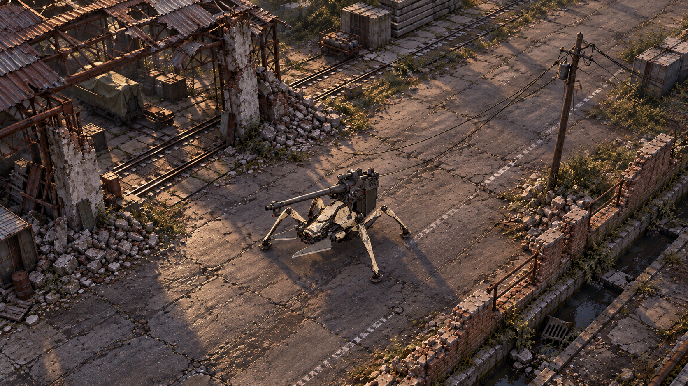
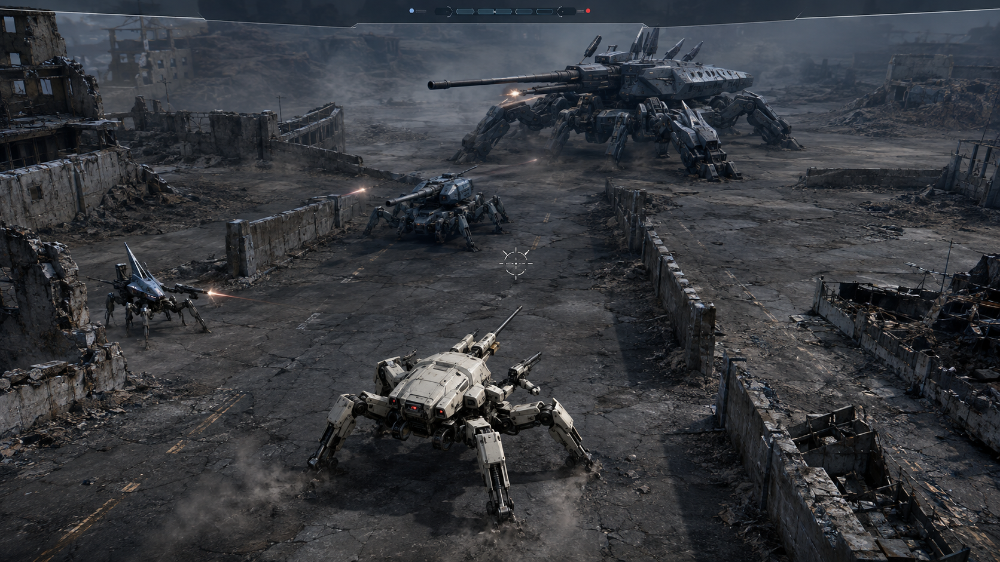

## S55 實機研究更新

模型組合已能在Godot渲染，但美術總監未通過整場完成度。下一輪優先完整鐵道環境，不再以單機／牆片微調代替進展。[實際構圖、匯入結果與驗收](s54-combat-reference.md)

# S54：先驗證完整交戰場景

2026-09-13：使用者指出單機／局部材質修補沒有改善世界觀與震撼感。最新順序改為「參考交戰 → 素材歸檔 → 我方、軍勢、真實比例Morpho同框 → 動畫與特效」。S53街角研究保留為歷史，已不是下一輪的主交付。

[交戰片段、素材庫與實作對照](s54-combat-reference.md) · [原作尺度與構圖](s54-encounter-reference.md) · [軍團模型依賴](s54-legion-assets.md)

---

# S53：先重整美術，暫停擴大 3D 玩法

2026-09-13 最新方向：使用者否決目前試驗場的視覺完成度。以下舊稿保留作歷史，不是最新產品驗收結果。

這張是美術概念稿，尚未在遊戲引擎重建。下一步先以現成模型、PBR 工廠素材與固定鏡頭驗證一個街角；3D 入口延續成熟 2D 介面。

- [最新美術規格與問題證據](s53-art-recovery.md)
- [現成素材、引擎比較與實際取得紀錄](s53-environment-pipeline.md)

---

# 《86》3D PC 美術方向：看得見重量，也看得見退路

> 2026-09-08｜設計候選，未實裝。本文與概念圖是美術目標，不是實機截圖、效能證明或交付承諾。以電腦鍵鼠與 16:9 畫面為本輪範圍；機制以 [3D 遊戲設計](3d-game-design.md) 為對照。正式遊戲與 S22 預覽不因本文件改動。

## 第一張戰場氣氛稿

這張生成圖用來評估冷色金屬、廢墟縱深、側擊路徑與遠大目標的氣勢。PO 審查：材質與尺度方向可保留，但視角仍偏低，遠方重機的輪廓也尚未精準對齊原作；不能把它當成已完成的模型或相機規格。灰盒仍先測下面的 42–50° 俯角，確認腳邊退路與四向威脅，再決定是否降低視角。

[模型、動作與特效素材盤點](3d-asset-survey.md) · [核心互動設計](3d-game-design.md) · [引擎與星海視角比較](3d-engine-study.md)

## 主決策：高位斜後方先做，肩後保留同場對照

推薦「能瞄準的高位斜後方」作第一個灰盒主候選。保留機甲在前景的厚度、砲管與完整四足，同時讓玩家看見側移通道與腳邊落點。這是美術判斷，尚未經真人驗證；不用一張壯觀的概念圖提前否決肩後方案。

| 比較項目 | 高位斜後方＋獨立瞄準 | 第三人稱肩後 |
| --- | --- | --- |
| 視距與地形 | 易看清低牆兩側、近路與遠砲來源；過高會把戰場壓平 | 地平線與遠大目標有氣勢；前方牆體較容易遮掉地面退路 |
| 四向威脅 | 側後方保留較多實景；仍有畫外盲區，不能聲稱全知 | 側後威脅常要依靠聲音／方向提示，玩家還須管理轉鏡 |
| 機甲可見性 | 四足、腳底接地、砲塔和側移能同時被看見 | 近看砲架與表面細節很強，但前景機體常吃掉足邊畫面 |
| 瞄準與命中 | 遠小部件難點；需要精瞄及真砲口遮擋提示 | 指向直覺、砲口後座有力；準心線與砲口線不一致仍須處理 |
| 首切片取捨 | 優先驗證繞掩體、斷鏈、側擊與獵兵逼位 | 使用同一場地、敵人與危險時序作對照，不先投入第二套美術 |

灰盒起始值：俯角約 42–50°、垂直 FOV 約 48–56°，玩家重心位於畫面約 `(50%, 64%)`；常態機體含足約佔畫面高度 15–20%。這些是可調起點，不是 AC6 或 Returnal 的量測值。使用透視相機，以道路、牆高與腳影建立深度；不要改成正交俯視來躲開 3D 構圖問題。

相機跟隨底盤平移，平滑吸收軀幹起伏，不隨每一步點頭或隨滑鼠準心持續繞轉。首輪保持穩定世界方位，WASD 相對畫面移動；滑鼠控制世界中的瞄準點。滑鼠移到極邊時最多小幅前瞻，不能突然把後方出口推出畫面。右鍵精瞄只收斂視野與準心，不自動切肩後；前景遮擋與足邊安全區要在精瞄時再驗證一次。肩後展示可先用於整備；戰鬥中不強制電影轉鏡。

## 證據及使用界線

- [AC6 官方 Beginner’s Guide，2023-08-23](https://armoredcore6.bn-ent.net/en/information/?p=22) 說明全方向三維移動、觀察敵人行為，以及失衡後的重傷機會。採用「姿態失衡與實際可攻窗口一致」；不把其人形 AC、空戰能力或多武器操作整套移植到《86》。本輪重新核對官方指南文字；没有把文字當作相機數值或完整實機錄影的量測證據。
- [Returnal 官方 UI/UX 設計文，2021-05-11](https://blog.playstation.com/2021/05/11/unpacking-returnals-ux-design-gameplay-first-ui-retro-futuristic-tech-and-accessibility/) 將即時生存資訊靠近視覺焦點、次要資訊放周邊，並討論字幕背景與大小選項。採資訊層級及可讀性；不採其取消標題頁的決策，也不以 CRT 雜訊作全介面的常駐裝飾。本輪引用方法說明，沒有宣稱新看完一場 Returnal 戰鬥。
- 本輪實際檢視本地保存的官方 XM2、M1A4、Ameise、Löwe、Dinosauria 機型圖，並核對 [第一部我方機](https://anime-86.com/mechanic/first-half/)、[第二部我方機](https://anime-86.com/mechanic/second-half/) 與 [軍團規格](https://anime-86.com/mechanic/enemy/)。圖能確認可見輪廓與塗裝，無法提供背面拓撲、關節極限或可直接使用的模型。

## 真正「較遠、較大」的 Boss

Dinosauria 要靠世界尺寸、行走重心與景物比較形成百噸重戰車的壓力：足掌跨過路面裂縫、砲身越過低牆、塵土沿腳底推出；機體保持在遠中景，前景玩家仍有兩側可走的路。正常交戰構圖先測 Boss 高度佔畫面 22–30%，而非只把螢幕模型放大。該比例是構圖目標，不能反推未核實的 Dinosauria 官方長高；比例不成立就調場地、相機與交戰距離，不動視覺比例而留下原碰撞。

Boss 的主砲、足部外緣及正在射擊的武器必須能被辨認；偶爾被真掩體遮住時，保留最後情報與來襲方向，不畫穿牆即時全輪廓。大型目標也不能永久佔滿上半畫面。Morpho 的體量與軌道砲另屬後續場景問題，不用放大的 Dinosauria 代替。

遠處外殼可以受少量大氣透視影響；砲口、動作剪影與致命射界仍保持局部反差。禁用戰鬥景深把實際敵人、準心目標或危險落點模糊。近身撞上 Boss 時才容許體量暫時超框，相機需先保住我方與最近逃生路徑。

## PC HUD 與遮擋規則

以下以 1280×720、1920×1080 兩個桌機尺寸檢查；介面數字不直接隨解析度等比放大。

- **焦點**：準心旁只放射擊準備／強化彈狀態，以及「砲口受阻」等立即改變操作的訊息。由相機射線決定意圖、由真砲口射線決定能否命中；牆角不能出現準心命中而砲彈穿牆。選中部件才有短名與受損提示，不給每一隻小兵常駐血條。
- **薄頂欄**：Boss 名稱與耐久置上中，1280 寬時約 360–440px、總高不超過 42px。待射狀態與部件圖示共用同一列；「主砲已發射」不能被核心開放的好消息蓋掉。左上為任務目標，耐久／彈量採固定短列，不再在機體上方疊大型統計板。
- **人物通訊**：1280 畫面右上偏側放 72×92px 胸像與一行約 18–24 字繁體短訊，整組寬約 260px、高約 100px。角色臉清楚、框體克制，對話時才出現。落位需避開當前重要武器及側向危險；若固定區與危險衝突，暫退成小型角色名與短訊，不靠透明度假裝沒有遮擋。
- **按鍵提示**：首次整備展示 `WASD 移動｜滑鼠 瞄準｜左鍵 射擊｜右鍵 精瞄｜R 強化彈｜Esc 暫停`。文字對齊實際機制；R 的動詞在機制確定後精確寫成裝填或切換。戰中只在教學或狀態需求時顯示一組提示，保留重綁後的真按鍵，不新增主動技能負擔。
- **遮擋處理**：鏡頭與我方之間的近景柱牆，可局部淡出遮住玩家的片段並保留邊界；其碰撞與擋彈能力不變。相機先嘗試縮短距離，避免穿牆；不可連遠方敵人也透視。危險投影貼合地面高差，煙塵不能淹沒其有效邊界。画外提示只對真來襲事件出現，不是永久環繞的敵人箭頭。

## 原作輪廓與材質：先辨機型，再看細節

| 機型 | 必須保住的形狀／武器來源 | 動態承重與材質取捨 |
| --- | --- | --- |
| M1A4 | 低矮駕駛艙、四根細長行走足、獨立副臂、背部 57mm 長砲架 | 官方圖的米灰塗裝、露出的深色連桿與磨損；步態有輕薄骨架的急停負荷，不做厚甲英雄胸腔 |
| XM2 | 四足、尖長足部外甲、與行走足分開的前副臂、背部可換砲架 | 官方圖偏白外甲、深色關節與少量紅色端點；屈足蓄勢、抓地、底盤平移後回正。不要把刀臂算成額外行走足 |
| Ameise | 尖楔感測輪廓與天線／感測部位，能先被看成斥候 | 頭部／感測朝向先找人，再移位；不替它裝一根與 Löwe 相同的大砲來省工 |
| Löwe | 寬厚甲體、明確突出的一根 120mm 長砲，厚足架砲 | 砲塔追蹤先於發射；重砲後座傳至底盤與支撐足，不讓整機等速滑動 |
| Dinosauria | 寬闊多足重戰車、巨大前伸砲組與背部裝甲，155mm 主砲／同軸 75mm 副砲 | 原圖的冷灰金屬與板片反差；把重量放在足底、砲架、鬆落部件。舊 2D 雙翼可拆砲是改編，不能照搬成官方結構；新可破壞武裝需另核位置 |

軍團官方圖有冷色金屬反光，3D 目標可保留這種材質差異，但讓粗糙度在大面板、裸露關節、砲口積碳之間有變化，避免整機鏡面鉻。磨損集中在足底、活動接縫與接觸邊緣；髒污跟重力和路面接觸走，不平均撒滿噪點。紅色用於實際感測、武器與危險狀態，不作全身霓虹輪廓。

Grauwolf 在機制灰盒中可先做前刃＋背火箭的可辨識關節模型；Eintagsfliege 是微小機雲，可用有深度排序的群集表現，不能變成大飛機。不要用改色的 Ameise 暫充這兩者再稱機型完成。

## 五拍攻防與擊毀收束

所有數字為動畫試作起點，動畫需由真攻擊狀態驅動；不能另跑一條漂亮但會說謊的計時器。

| 拍點 | 主體動作 | 地面／光效 | 可讀性底線 |
| --- | --- | --- | --- |
| 警示 | 砲塔先尋向，玩家能找到武器來源 | 僅真威脅路徑出現邊界及端點 | 不用畫面紅閃代替方向；預告長度由機制提供 |
| 蓄勢 | 支撐足張開、底盤下沉、砲架鎖止；末段短暫穩定 | 足底材質被推開，砲口局部熱光，其他效果退位 | 最後穩定姿態讓玩家知道接近發射，不整台發白 |
| 發射 | 砲管先後座，再帶動砲架與軀幹；砲彈從 socket 出發 | 初試 40–80ms 砲口亮核及短定向衝擊，煙從來源展開 | 有射線不代表瞬間命中；照真彈速／光束規則演 |
| 命中／閃過 | 命中部位有受力偏移或板件反應，閃過不播受擊姿態 | 沿接觸法線飛出的火星、碎片與局部塵土；落地留下短痕 | 一般子彈低亮，小怪不全屏白閃；傷害大小不能只靠更大數字 |
| 冷卻 | 砲架回位、底盤回復，失能部件保持停機 | 熱光收斂、塵土散去，露出可攻部位 | 窗口結束立刻更正提示；其他武器仍待射就保留危險主次 |

受擊震動先測 80–140ms 短脈衝，只傳達命中方向，不每發子彈震全畫面；強度可降至零。後座以模型動畫承重，攝影機不綁腿部骨架。不要為爽快凍結玩家輸入或未命中的來襲砲彈。

菁英收束初試 0.6–1.0 秒的武器失效、失衡塌落、局部二次爆炸，殘骸可留 2–3 秒；過程不擋仍在作戰的玩家。Boss 收束初試 2.0–3.5 秒：部件崩解→主體失能→沿內部位置連鎖爆破→敵方感測標記熄滅，然後辛依真戰況回報、蕾娜回應。只有戰鬥已結束才可稍收近鏡頭；對話可略過，不拿它填長有效戰鬥。普通干擾只影響雷達／火控層；[官方 Para-RAID 設定](https://anime-86.com/keyword/) 不支持因電波干擾而必然中斷人物通話。

## 四個頁面同一場戰爭

| 頁面 | 美術與人物存在感 | 動態與操作 |
| --- | --- | --- |
| 標題 | 同一機甲、同一灰冷戰場與暖色遠光；標誌保留乾淨字面，蕾娜有一則接線開場 | 一次清楚的標誌揭示與緩慢背景視差；主按鈕穩定可點，不等動畫播完 |
| 整備 | 機甲佔主要展示區，蕾娜肖像／機型建議在側；同套名稱、狀態色與字級 | 可旋轉檢視真模型，切機型時保留大致尺度參照，不把每台都硬塞成等大 |
| 戰中 | 暗面低噪、亮度集中在接地、武器來源和命中；人物只在真事件出現 | 不搬整備大立繪入射界；通訊優先級與存活狀態沿用既有真實性規則 |
| 結算 | 留下真正損傷機甲／殘骸，再由辛報告、蕾娜回應；勝敗用內容與按鈕權重區分 | 勝利重點為下一步，失敗重點為重試；統計隨時可讀，不等角色說完才可操作 |

靜態肖像可繼續使用現有蕾娜、辛圖，不把它們稱作 Live2D；封面概念圖可作獨立主視覺，不能冒稱由遊戲引擎即時渲染。

## 素材與 3D 工作量：先有一台真的能動

現有 2D 機甲 atlas、裁切副砲與背景只提供外觀／構圖參考；它們沒有背面、體積、UV、骨架或碰撞。GLB 是交付容器，不會替圖片補出正確關節。現有角色肖像、UI 圖示和已核實授權的聲音可依用途延用；2D 煙火若要作 3D billboard，仍須驗證透明排序、場景遮擋與光照一致性。官方參考圖也不等於可再散布的 3D 模型授權。

美術製作先後順序：**一架玩家 XM2 或 M1A4 完整動作**→Ameise 與 Löwe 的情報／砲擊對照→Dinosauria 的全身承重及一組真破件→其餘機制敵人逐步精製。設計仍可用灰盒測全部遭遇；不要同時承諾完整四兵種、雙玩家機與雙 Boss 都達到概念圖品質。沒有建模／動畫人力與效能基準前，不估「幾天全做完」。

| 必要交付 | 最小可用內容 | 不能省掉的驗證 |
| --- | --- | --- |
| 機體模型 | 全面可看的封閉主要外殼、分離活動硬表面、UV、基本色／法線／粗糙度／金屬材質；至少一個簡化遠距版本 | 側後與低角度不露空洞；材質不能靠烘焙在正面圖上的假陰影成立 |
| 多足關節 | 獨立 root／body，每條腿有髖、膝、末端足節的可動鏈與足底接觸點；具體軸向依模型核定 | 平地、坡面、轉向、急停不滑足／穿膝；後續可接足部 IK，不假設 GLB 自帶 IK 求解器 |
| 武器節點 | 砲塔 yaw、砲管 pitch、後座節點；每個 muzzle／shell eject／可破件有明確節點名稱與局部軸向 | 轉砲、抬砲及底盤傾斜時，彈道、煙火、命中與拆件仍跟真世界座標一致 |
| 動作片段 | 待機、前進／後退／側移、轉向、急停、蓄勢／射擊／回復、受擊、失能 | 原地骨架測試通過後再接位移；砲塔瞄準能和腿部移動組合，不需每個方向重做一套整身動作 |
| 碰撞與破壞 | 簡化移動碰撞、可受擊部件、脫落殘件分開；先一組可測破件，不做全機逐片物理碎裂 | 破壞後對應武器真的停用；掉件不永久封死出口，視覺與真 hitbox 不分家 |
| 場景與 VFX | 一套低牆、路面、中央殘骸與遠景；腳塵、砲口、定向命中、少量二次爆破 | 不先堆城市資產；1280×720 下先確認剪影、危險落點與地形可讀，再談高解析貼圖 |

## 16:9 主戰鬥概念圖 prompt

使用前附上已核對的官方機型圖作形狀參考。這張圖只展示美術方向：兩台我方同框是比例參考，不代表首版承諾可控隊友。若生成結果把四足變成人形、砲組變成泛用機械翅膀，應退件，不用特效遮掩。成品頁面需另標「美術目標・非實機畫面」。

> Create a 16:9 art-direction target for a PC 3D tactical mech action game inspired by 86 EIGHTY-SIX, NOT an actual gameplay screenshot. Elevated oblique rear perspective, approximately 45 degrees downward, natural perspective depth. Use the supplied official reference images as the authority for machine silhouettes. Foreground: one XM2 Reginleif, a low compact white armored cockpit, exactly four articulated locomotion legs, separate small forward weapon sub-arms, and a physically supported dorsal 88 mm cannon mount. Show distinct feet gripping broken asphalt, dark mechanical joints, subtle red hardware accents, and believable suspension load. A smaller M1A4 Juggernaut ally at the far left provides scale: weathered ivory-gray lightweight four-legged chassis, separate blade sub-arms, narrow dorsal 57 mm cannon. Neither machine has a human torso, head, hands, or biped stance. Midground: an Ameise scout with its sharp sensor wedge and antenna silhouette observing from a ruined corner; a separate Löwe heavy multi-legged tank with thick armor and one clearly identifiable long 120 mm cannon behind a low wall. In the distant center, a much heavier Dinosauria dominates through real scale and depth: broad low multi-legged armored body, long 155 mm main gun with a coaxial 75 mm secondary, layered dorsal armor; preserve the reference silhouette, no floating twin side cannons, no humanoid boss. Show its braced legs and a restrained hot muzzle at the end of charge. Keep its complete weapon silhouette readable. Reserve traversable space around both sides of the player and an unmistakable escape route between concrete cover. Cold overcast ruined battlefield, desaturated painted armor, rough steel, localized edge wear and grounded dust, small warm lighting accents. Weight comes from foot contact, recoil-ready joints, material contrast and scene scale, not neon outlines or oversized explosions. Sharp battlefield readability, no combat depth-of-field blur. Minimal thin HUD composition only: a small reticle and clear top-edge reserve for a boss bar; no readable generated text, no large portraits covering danger lanes. Polished game-art target with plausible hard-surface construction, no holographic rings, no full-screen bloom, no generic biped robots.

## 三個玩家可驗收標準

1. **看得懂，也走得出去。** 在相同灰盒用兩種鏡頭完成側移射擊、倒退瞄準與繞牆；玩家不必讀教學即可指出 Ameise、Löwe 的不同作用，並在一次重砲與側襲中找到真可達的退路。若只能靠不斷轉鏡或巨大箭頭求生，高位主候選也不算通過。
2. **看見重量，也相信命中。** 關閉震動與大部分裝飾粒子後，玩家仍能從足部、砲架與姿態辨認警示→蓄勢→發射→命中／閃過→回復；牆角遮擋、砲口出彈與可破件位置一致，拆掉的武器在下一循環確實停火。不能只靠血條證明打中了。
3. **戰鬥和結果都說真話。** 在 1280×720 與 1920×1080 下，玩家能讀取耐久、彈量與當前致命威脅，人物通訊不蓋準心、武器來源或最近退路；Boss 收束可辨部件失能與主體塌落，辛／蕾娜依真結果回報，重試／繼續可直接操作，沒有用不可略過演出湊時長。
