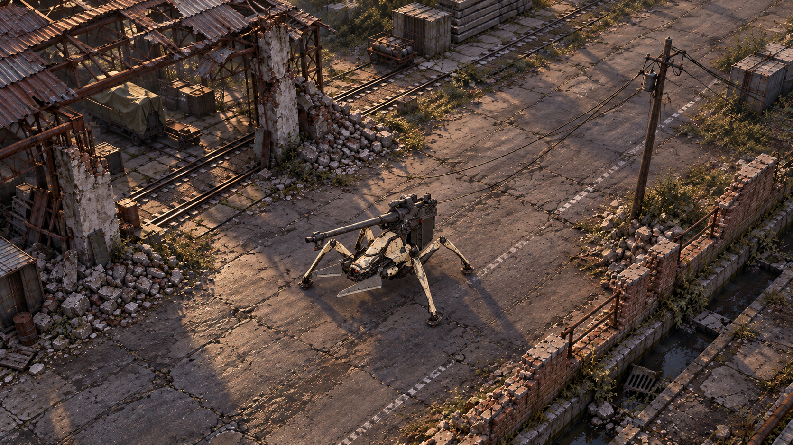
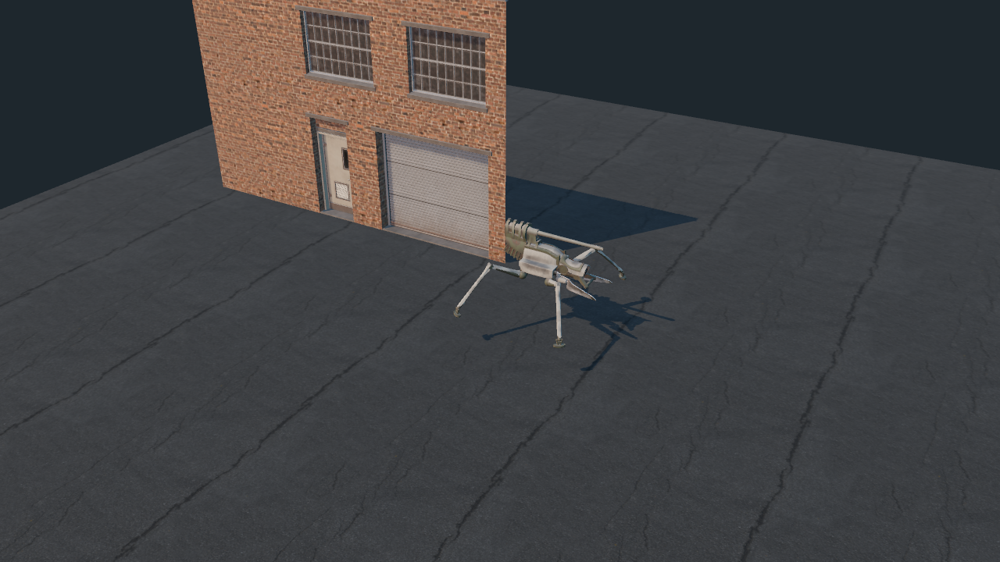
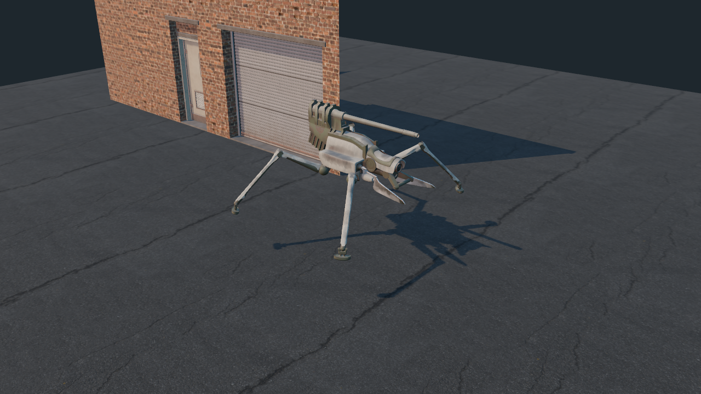

# S53 美術重整：先完成一個可信的街角

2026-09-13，美術診斷與 look-development 規格。這是下一輪製作提案，尚無本規格的引擎場景或成品截圖；沒有修改 runtime、同步 8765 或發布。

本輪目標是讓一張無 UI 的真實引擎畫面，已經能成立為《86》改編的工業廢墟。先完成 24 × 32 m 的街角，暫不擴大地圖。高品質來自場景構成、模型、材質和光照共同成立；換引擎或加 HDR 本身不是成品保證。

## 視覺目標稿：斜俯視廢棄維修廠

**這是 AI 生成的美術概念稿，不是遊戲截圖，也不代表引擎場景已完成。** 第一稿俯角太低、偏電影鏡頭，已改為較高斜俯視。正式實驗會在約 40–55° 之間，以可行走區、機體辨識與障礙物遮擋決定鏡頭，而非盲目對齊生成圖。保留污白裝甲、暖斜光與冷灰環境、破損屋架、磚欄與安靜路面；圖中碎片密度、機體比例仍須以遊戲素材重新驗證。

[場景資產與引擎比較](s53-environment-pipeline.md)。正式入口沿用 2D 主畫面、模式卡、設定與通訊元件；不把試驗場的獨立粗糙 UI 當新產品介面。

## 已看證據與未證實判斷

|直接檢查的證據|可證實的問題或價值|不能由此推出|
|---|---|---|
|`game-3d-models.js:21–44`|環境混凝土、頂面、鏽、污漬主要是純色 PBR 常數；裝甲 metallic .36、roughness .44 是單一數值|單一參數不是塑料感的唯一成因；不能承諾把 metallic 改成某值就修好|
|`game-3d-models.js:271–364`|主要地表是 106 × 124 的平整盒體；只有瀝青載入 albedo/normal。掩體是完整盒形加頂蓋，建築等距重複，碎塊多在外圍|已經有裂紋法線不等於有破裂地形；多加隨機方塊也不等於廢墟|
|`game-3d.js:14–27`|全場 EXP2 霧、半球光 .88、方向光 1.8、1024 低品質 PCF；未設定環境反射貼圖，沒有本檔配置的 AO/GI/材質診斷視圖|缺少環境反射是待做 A/B 的因素，不足以把所有暗部或廉價感歸因於引擎|
|`probe-assets/lighting-b.png`|這張留存對照圖仍是平面道路、重複裂紋、完整牆盒與程序機甲；地景缺少厚度、破損與生活痕跡的中層細節|它是 S49 隔離診斷，不能冒充最新 S52 runtime 畫面；A/B 同時動多個變數也不能單獨歸因|
|`probe-assets/s52-idle-001.png` 與 `s52-render-motion.py`|S52 圖是 Workbench 的 STUDIO/TEXTURE 動作 QA，機身很暗，足下沒有場景接觸|這不是 PBR 材質驗收。不能由此宣稱真模型在成品照明下必然全黑|
|實看 `/private/tmp/s51-project86-juggernaut/2k-Robot_2_Base_Color.png`|Project-86 atlas 有大量淺灰裝甲 UV 島、深色零件與明暗紋理；不是整張有效表面都黑|UV 空白的黑色比例不能當機體反照率；仍須核 UV 對應、貼圖色彩空間、材質倍率與匯入結果|
|實看使用者新模型原始 `SADASD_ARMOR_BaseColor/Roughness.png`、`SADASD_BODY_BaseColor.png`|2K 原圖有污白裝甲、粗糙度差異，以及機械部件的綠漆與鏽蝕；可供靜態材質驗收|細節是否在遊戲鏡頭仍清楚、鏽蝕是否過量、法線方向是否正確，尚未驗證|
|`probe-assets/s52-sketchfab-inspection.json`|既有檔案稽核記錄新 GLB 為 95,482 三角形、7 材質、21 張內嵌 1K PNG、無 skin/animation|面數與貼圖張數不是美術分數；新模型仍不是可直接替換的動畫玩家|

已直接檢視的原作圖：`images/official-m1a4.jpg`、`images/story/img_ep09-1.jpg`、`img_ep01-4.jpg`、`img_ep10-1.jpg`、`img_ep10-5.jpg`、`img_ep21-1.jpg`。只有 EP09-1 可作主要道路／殘牆參考。它可見破裂鋪面、磚欄、電線桿、垂線、彈殼與遠景樹林；不能據此確定工業廠區身分。EP01-4 支持污白裝甲、深色機械與局部紅感測器的分工。EP10-5 只補自然暖光，EP21-1 是室內人物，不作戰地依據。來源與限制見 [既有逐圖記錄](images/story/SOURCES.md)。本輪官網第 9 話頁重讀逾時，未聲稱重新核實線上圖片內容。

## 唯一製作方向：廢棄鐵路維修廠外緣街角

這是本專案的改編場景，保留《86》的脆弱多足機械、磨損軍用表面、戰後寂靜與有人曾在此生活的環境證據。不是原作特定街道重建。

**尺度與構圖。** 先按公尺建立 24 × 32 m 核心區，外圍只延伸可見的屋架、管線與樹影。M1A4 用官方全長 5.4 m、機體高 2.1 m（不含背部武裝）作尺度校準；不得拿腳展寬直接當全長。路面淨寬 9 m，路緣高約 .15 m，棚體高 5–7 m，常用門高約 2.2 m，都是本場景設計值。[M1A4 官方規格](https://anime-86.com/mechanic/first-half/)

以 16:9、1920 × 1080 作共同輸出：相機俯角先定 40°、繞垂直軸約 35°、垂直 FOV 35°，使用透視投影。調距離讓機甲腳尖到腳尖占畫面寬 18–23%，道路從左下進入並向右上延伸。這些是待驗收起點，不是原作鏡頭參數。畫面可見至少三隻分離足端與砲管朝向；不要用濃霧或景深藏住可行走區。

|畫面位置|必做形體|功能與細節分配|
|---|---|---|
|左側／中景約 1/3|局部倒塌的維修棚：兩根斷柱、一段外露屋架、破裂混凝土基座、少量殘留波紋板|形成最大暗部與可辨工業身份；牆斷面有厚度、骨材與鋼筋，窗洞是真洞，不是黑色矩形貼片|
|中央／下方|破裂路面與 M1A4；一段翻起路緣和向排水溝傾斜的小片路板|道路保持最大安靜面；裂縫有主次及成因，避免整張相同大小的裂紋格子。機體背後有較單純背景|
|右側／前景|斷磚欄、彎欄杆、排水溝，三組大小不同的碎石堆|建立近景遮擋與足下重量。碎片聚在牆腳與坍塌源下方，不均勻撒滿地圖|
|右上／遠景|管線支架、一座水塔剪影、斷電線桿與鬆垂纜線，背後少量樹冠|建立縱深和場景識別。避開砲管與腳部輪廓，對比低於中景，沒有全場招牌或霓虹|

破壞設計先做一個可理解的事件：棚體左前角遭衝擊，破口往路側倒，碎塊由大到小向路緣衰減。第二層才是長期風化：牆腳積灰、金屬下方流鏽、凹處潮濕、少量裂縫雜草。第三層只放兩組敘事物件：維修用管線／舊工具箱，以及機體附近少量彈殼。不要用滿地貨櫃、規律路障或隨機污漬替代場景敘事。

## 材質與光照分工

下列 roughness/metallic 是製作初值範圍，不是從動畫測得的物理值；同鏡頭對照後調整。

|表面|可見結果|製作分工|
|---|---|---|
|M1A4 污白烤漆|暖灰白大面能讀清，刮損集中邊緣與受磨部位，禁止全身均勻光亮|漆層 metallic 0，roughness 約 .55–.8；露金屬另用 mask、metallic 接近 1。保留原圖污損，不直接覆蓋一套純色|
|關節、砲管、刃面|深灰機械與淺裝甲分離；活塞／刀刃有窄而穩定的高光|依部位區分裸金屬、漆與油污；刃面 roughness 約 .25–.4，深色機械約 .45–.7，不把整台設成中金屬度|
|混凝土／磚|受光暖灰，破口偏新鮮、牆腳偏髒，距離拉遠仍有大尺度差異|metallic 0，roughness .8–.98；tile 材質加宏觀色差、頂／側面灰塵、少量裂痕 decal；斷面用網格 |
|瀝青／泥灰|低飽和冷灰棕，道路比裝甲暗，裂縫不成規則棋盤|metallic 0；乾路 roughness .8–.98；僅排水溝旁少量潮濕區 .3–.5，不以鏡面雨地掩蓋單薄模型|
|波紋板／管線|鏽只依積水、接縫、刮損出現；凹凸和邊厚可讀|漆、裸金屬、鏽三者遮罩分開；不能把棕色鏽統一設為金屬|

主照明選**雲隙低斜陽＋冷灰天光**：暖光從畫面左上後側打到裝甲頂面與破牆斷口；冷灰填光保留底盤關節。暖光有方向，陰影依建築遮擋形成大面積組合。曝光固定，先不加 bloom、色差、重 vignette 或大景深。M1A4 裝甲是持續可見的最亮大面，感測器只占小面積，爆炸才允許短暫過曝。

既有 `probe-assets/industrial-sunset.hdr` 可作環境反射候選，不把它當背景街景，也不代表已選定日落橘色。先中性環境驗材質，再用此 HDR 的方向／曝光建立 A/B，避免強烈色調掩蓋材質問題。腳尖、履帶式殘骸、牆腳需有接觸陰影；遠景霧僅降低遠景對比，近景不可洗灰。

引擎製作比較固定分四次輸出：①灰材質只看構圖與破損形體；②無照明 albedo 看 UV／分色；③中性光＋反射看 roughness／normal；④最後光照加全部材質。各輪使用同一相機，另出一張足端與牆腳近圖。S52 Workbench 動作圖只能放在動作 QA 欄，不混入實機畫面比較。

## 現成資產與真正缺口

|資產|本輪用途|尚缺／處理|
|---|---|---|
|使用者 `assets/model/juggernaut_86_eighty-six.glb` 與原 2K 紋理|優先做單機靜態 lookdev，和官方M1A4輪廓比對|核全長尺度、正面、足端著地、貼圖色彩空間、packed 通道與 normal。尚無逐足骨架，不以本輪美術提案承諾動畫可用|
|`probe-assets/s52-juggernaut-motion.glb`|保留步態與關節研究價值，放入同場景比較|先找黑暗呈現原因；不能一面嫌太暗一面盲目放大環境光。先判 UV／材質／色彩空間，再判重新繪製|
|已有瀝青 albedo＋normal|道路基底與比例參考|缺宏觀色差、粗糙度、路板斷面、路緣與不重複的破損層|
|Kenney `building-a`、`water-tower`、`shipping-container-a`|可暫供構圖尺度、遮擋的灰盒|乾淨低細節造型不能直接當最終工業地景；本場景沒有必須用貨櫃的理由|
|既有 HDR、煙霧圖集|反射測試及完成後少量遠景煙霧|不先堆特效；煙霧不得遮住低品質場景來通過驗收|
|**必須補的 6 組環境資產**|①有厚度的斷牆／斷柱；②真屋架與波紋板；③破路緣／排水溝；④磚欄／彎欄杆；⑤3 尺度碎片；⑥電線桿／垂線／管線|可從具備來源的資產開始改造，或在 Blender 製作。每組需有合理比例、UV、正常法線、材質分工；不能再用相同 box 加色帶完成|
|**必須補的 4 層表面資產**|混凝土、磚、漆金屬／鏽、灰泥混合；另少量裂縫、流鏽、積灰 decal|以固定實景鏡頭驗收，不拿高解析 texture 球或 close-up 當成遠鏡頭有效證據|

## 給實際場景製作者／引擎研究的需求

選引擎依據是：能快速擺景並保存攝影機、能修改材質實例與局部混合、支援 decal、能穩定讀出近景接觸與斜俯反射、能反覆輸出相同鏡頭。靜態環境允許烘焙照明；機甲與後續動態物件需與之融合。先把這個場景在候選工具內完成，再討論擴張與平台；目前不能以「瀏覽器能跑」作畫質上限。

The Ascent 的開發者一手訪談提到：場景層次仰賴資產管線、可調 master material 與實例、場景組件；照明混合烘焙與動態，且斜俯視反射更依賴 probes。可借鑑其製作流程與攝影機針對性，不能把它的霓虹都市色彩移植成《86》。該訪談也沒有證明改用 Unreal 就能自動得到同等美術。[Epic／Neon Giant 官方開發者訪談，2020-11-25](https://www.unrealengine.com/developer-interviews/11-person-studio-neon-giant-delivering-next-gen-passion-project-the-ascent)

## 可直接用於概念圖的 brief

> 一張 16:9 的《86》改編工業廢墟場景概念設計，採略作收斂的寫實遊戲美術：可信材質、清楚色塊與輪廓，避免攝影級細碎噪點；供真實 3D 引擎重建，畫面不含 UI、文字或 logo。斜俯視透視相機，俯角約 40 度，畫面中央偏下是一台忠於參考圖輪廓的 M1A4 四足破壞神：低矮尖頭、污白裝甲、深灰機械關節、背部長砲管、前方雙刃，四足有明確接地與遮擋關係。機甲占畫面寬約五分之一。場景是一段廢棄鐵路維修廠外緣街角，左下道路延伸到右上；左側倒塌維修棚可見真實屋架、斷柱與有厚度的混凝土破口；右側是局部倒塌磚欄、彎欄杆、排水溝和牆腳碎片，遠處一座水塔、管線支架、垂線與少量樹影。破壞從棚體一處衝擊點向外衰減，不均勻散布雜物。雲隙暖色斜陽照到機甲頂面與斷口，冷灰天光保留陰影機械細節；低飽和灰棕地景、深色機械、污白裝甲形成層級。地面主要乾燥，只有排水旁少量潮濕。每個破口、纜線與陰影有可建模的結構依據。近中遠三層深度清楚，保留安靜的行走空間。避免霓虹、塑料高光、乾淨積木、對稱箱陣、全屏裂紋、均勻鏽蝕、強景深和過量粒子。

使用原作 M1A4 與 EP09-1 參考圖引導形體和環境語彙；如果產生概念圖，展示時明寫「概念目標，非實機」。它只供構圖討論，**不算**模型、光照或引擎性能完成。概念圖若出現不可能重建的機甲結構／破損，也應被退回。

## 玩家能評判的下一個交付

交付同一街角的兩張真實引擎圖：完整場景斜俯視與足端／破牆近圖，外加 10–15 秒緩慢平移或轉角，證明是真 3D；先可用靜態機甲，不以滑步動畫轉移注意。必須能分辨漆、裸金屬、混凝土、磚、瀝青；辨識機體輪廓、讀到屋架與破口厚度、看出每個腳尖壓在地上。從遠鏡頭仍看不出這些，繼續改場景，不擴功能。

進入方式沿用已成熟 2D 的 `index.html` 品牌、背景構圖、`mode-card`、主按鈕與通訊樣式。3D 只新增同級模式 tile；圖面用通過驗收的實機截圖，文案說玩法／場景，研究狀態另小字標示。目前 `index.html:16` 只是研究連結，而 `sortie-3d.html` 另造一整套 mission-card；下一輪不以這套獨立入口為基準。沒有美術 ready 的場景前，不重造主頁，也不把它推成正式模式。

## S53 實際引擎診斷：Godot Metal，尚未通過美術驗收

2026-09-13：Godot 4.7.2 官方 macOS 包已在 Apple M3 的 Metal 3.2／Forward+ 完成實際渲染；三張 1280×720 PNG 已讀取檢查，最後一次執行沒有匯入警告或腳本錯誤。這是完整立面、道路、機甲的診斷場，**不是前述廢墟概念的完成品，也不代表已決定改用 Godot。** 尚缺相同輸入的 Babylon 對照與編輯器重新匯入成本驗證。

- 修正：自行讀取的道路／模型材質 texture 加入 mipmap，並開啟 4×MSAA。最初的遠景顆粒已改善；同時改過取景與道路明度，不能把所有差異都歸因於單一參數。
- 修正：模型四個 material 宣告 normal 用 UV1、base color 用 UV0，Godot 不支援分離配置。逐頂點確認兩組座標完全相同後，衍生 GLB 的 normal 索引統一為 UV0；二進位幾何／貼圖原樣保留，使用者來源檔未修改。
- 修正：由砲管包圍盒確認來源的前後軸是 X；不再取最大水平包圍盒而誤把 Z 腳展當全長。5.4 m 仍是此診斷的尺度基準，不保證模型各零件都忠於原作比例。
- 有／無 SSAO 使用相同鏡頭與燈光保存：[關閉 AO 的實際對照](images/s53-godot-material-no-ao.png)。目前只保留供後續判讀，未以有開效果就判定品質提升。
- 獨立 Astra 美術 Review：污白貼圖可讀、足端陰影存在；但裝甲／機械分色仍弱，薄腿在遠處缺乏存在感。磚牆材質過密、完整立面缺少厚度與縱深，不能當作主要維修棚。

**下一個實作優先序已改變：** 先補一跨有厚度的屋架／斷柱與可辨材質分區，工廠組退居殘存翼樓或遠景；不擴大地圖、不繼續添加整面磚牆。兩輪診斷仍未達美術目標，不能用可載入／可渲染的成果取代玩家要求的完成度。
