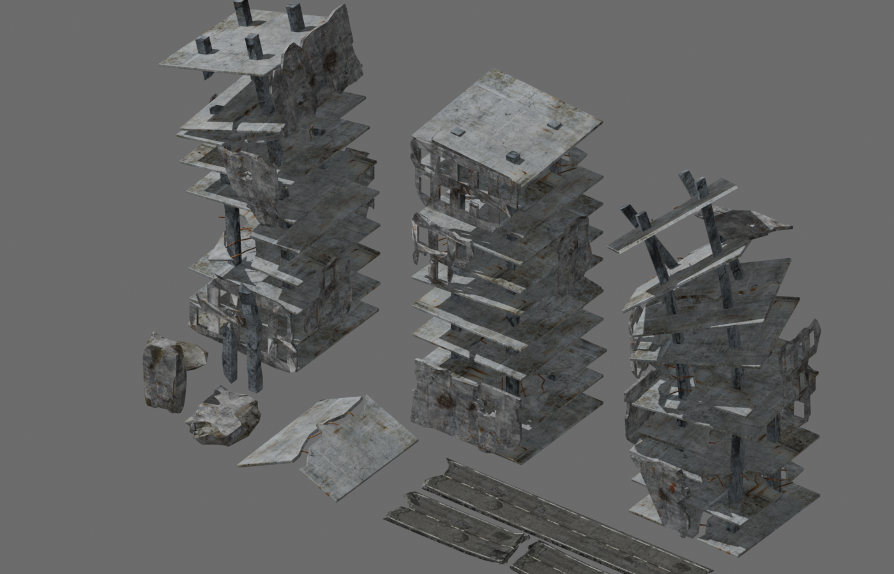

# S53 環境美術管線：先驗一個寫實街角，不再做程序盒地景

日期：2026-09-13。這份筆記只回答下一個場景美術試驗，不重列引擎名單，尚未實裝引擎場景；下方另記錄已完成的素材取得。

## 建議決策

下一個最有效試驗是用 **Godot 4.7.2 stable、Forward+、固定攝影機** 做一個 24 × 32 m「廢棄鐵路維修廠外緣街角」靜態可走切片。只放現成 PBR 模組、M1A4 現有 GLB、一道方向光、一張 HDRI、SSAO 與 3–5 張污損／輪胎／裂縫 decal；不先移植戰鬥規則，也不寫程序建築生成器。Godot 官方 archive 目前把 4.7.2 列為 stable；macOS 官方包是 Intel／Apple Silicon 通用版。[Godot release archive](https://godotengine.org/download/archive/)

理由不是 Godot 畫質上限較高，而是這個試驗能最快驗證目前真正未知的環節：美術能否在編輯器內擺出有厚度的斷牆、破裂路緣、屋架／排水溝與可控光影，並在替換來源檔後保住場景編排。現有 Babylon 樣板已證明操作與 GLB 載入，卻仍以程式建立盒狀地景；再調 renderer 參數不會補出缺少的輪廓、碎裂幾何與表面變化。

## 三個可下載候選

|順位|資產與用途|授權／格式／貼圖／大小|引擎與 Mac 判定|
|---|---|---|---|
|1|[Poly Haven Modular Factory Facade](https://polyhaven.com/a/modular_factory_facade)：磚牆板、窗、門、loading bay 等寫實工廠外牆模組，先搭維修棚與遠端立面。|Poly Haven 官方頁明列 CC0；Blend／glTF／USD／FBX；1K、2K、4K、8K；brick、doors、garage、trim、windows 各有 diffuse、OpenGL normal、packed ARM，部分另有 displacement／alpha／metallic；53.3 m 寬、175K tris。官方 [files API](https://api.polyhaven.com/files/modular_factory_facade) 顯示 **1K glTF 主檔＋bin＋15 張 JPEG 共 17,626,179 bytes（約 16.8 MiB）**；頁面的 900.83 MB 是目前所選 8K 組合，不是本輪下載量。|不是 Unreal／Unity 專用，Godot 官方推薦 glTF；Mac 可直接使用。**本輪首選下載**：網站可免登入選 1K glTF，亦有官方 CDN/API 直連，不依賴 Epic session。|
|2|[Industrial Brick Ruin Wall Brick Straight 02](https://www.fab.com/listings/b20fff98-31fe-444e-a8fd-1d72e49b6b0b)：寫實掃描斷牆，補足盒牆最缺的厚度、破口與剪影。|Fab 頁明列 Free；Quixel Megascans；FBX／glTF／converted GLB／USDZ；AO、base color、bump、cavity、displacement、gloss、normal、roughness、specular；實體約 0.83 × 2.66 × 4.89 m，closed mesh。**貼圖像素與各 quality tier 下載大小未公開，下載前需在取得畫面記錄。**|交換格式可進 Godot／Blender／Babylon，不是 Unreal-only。Fab Standard License 允許任何相容工具。Fab Launcher 官方支援 Mac，但舊 macOS 版本可能受 Launcher 系統需求限制。|
|3|[Modular Sidewalk Corner](https://www.fab.com/listings/1c910259-6253-431c-bb80-566e4aa14f55)：4 × 4 m 破損、風化街角，直接提供道路轉折與斜俯視構圖錨點。|Fab 頁明列 Free；FBX／glTF／converted GLB／USDZ；AO、normal、base color、bump、specular、cavity、roughness、gloss，displacement 只有 high tier；實體 4 × 4 × 0.33 m，open mesh。**貼圖像素與下載大小未公開。**|同上，通用交換格式，不限 Unreal／Unity；Mac 可用。open mesh 表示它是表面模組，不應拿來當有厚度或封閉碰撞體。|

Poly Haven 的授權頁確認站上 HDRI、texture 與 3D model 全部是 CC0，可商用、免署名，也可再散布。[Poly Haven license](https://polyhaven.com/license) 這使第一輪能先拿到真實 PBR 幾何並開始擺景；Fab 的兩件只作第二輪補破口與街角，不讓登入狀態阻塞試驗。

Fab 的授權頁寫明 Standard License 可私人／商用、修改、整合進成品、使用任何相容工具，且不要求署名；禁止把來源資產單獨再散布。[Fab Standard License](https://www.fab.com/eula) 上述兩個 listing 同時標示 NoAI；Fab 官方規則說 NoAI 不能配 CC-BY，必須使用 Standard License。因此可合理判定為 Standard，但 listing 的「License terms」欄目前顯示空白，**加入 Library 時仍要截記實際 license tier；若不是 Standard，就停止下載。**[Fab licenses and pricing](https://dev.epicgames.com/documentation/en-us/fab/licenses-and-pricing-in-fab)

Fab Launcher 官方支援把資產匯出到 DCC／引擎與自訂目標；素材本身的 FBX、glTF／GLB 等交換格式才是這裡的關鍵，材質自動設定仍可能因目標工具而不完整。[Exporting assets from Fab in Launcher](https://dev.epicgames.com/documentation/en-us/fab/exporting-assets-from-fab-in-launcher)

不把 [The Wasteland LITE](https://assetstore.unity.com/packages/3d/environments/industrial/the-wasteland-lite-73054) 當首選。它確實免費、50.8 MB、55 個 modular prefabs、1K／2K textures、normal 與 occlusion，但原始 Unity 版本是 5.3.3（2016），交付是 Unity Asset Store package；頁面也沒有證明包含一個符合本構圖、可直接沿用的完整 scene。它可能省模型搜尋，卻先引入舊 Unity 資產轉換與材質修復。這輪沒有找到一個同時「免費、寫實工業廢墟、目前 Unity 版本可直接開、完整小場景」且明確比通用 GLB 更省事的官方候選，因此不建議為它安裝 Unity。

## Godot stable 桌面環境與既有 Babylon 的實際差異

|工作|Godot 4.7.2 stable 桌面 Forward+|沿用目前 Babylon 路線|對本試驗的含意|
|---|---|---|---|
|擺景與重新匯入|GLB 直接匯成 Godot scene；Import dock／Advanced Import Settings 可逐物件預覽、改 root scale、material override、碰撞與重新匯入。`.blend` 亦可透過 Blender 的 glTF exporter 自動轉入。[Godot 3D formats](https://docs.godotengine.org/en/stable/tutorials/assets_pipeline/importing_3d_scenes/available_formats.html) [Import configuration](https://docs.godotengine.org/en/stable/tutorials/assets_pipeline/importing_3d_scenes/import_configuration.html)|既有 runtime 可直接載 GLB，程式整合成本最低。另有跨 Mac 的 Babylon.js Editor，可拖放 GLB、編輯 PBR material；但它是另一套專案工作流，新專案會管理／更新 npm dependencies，必須驗證是否適合接回現有手寫 runtime。[Babylon.js Editor](https://editor.babylonjs.com/documentation) [Composing scene](https://editor.babylonjs.com/documentation/basics/composing-scene)|Godot 比較的是「整合式場景編輯是否省時間」，不是 renderer 上限。Babylon Editor 不能先算成既有專案已擁有的能力。|
|IBL／環境光|WorldEnvironment 可在 Inspector 集中設 sky、ambient、reflected light、fog、tonemap；PanoramaSkyMaterial 直接吃 HDR／EXR，天空即提供 ambient 與 specular IBL。[Environment and post-processing](https://docs.godotengine.org/en/stable/tutorials/3d/environment_and_post_processing.html)|Babylon PBR 可用 `environmentTexture`；Editor 可把 HDR 轉 `.env`，解決載入與 IBL 品質／體積。[Babylon Editor skybox](https://editor.babylonjs.com/documentation/tips/creating-skybox)|兩者都做得到；Godot 的優勢是同一 Inspector 內調整並立即構圖。不能把 IBL 的存在當成自動寫實。|
|SSAO／tonemap|Forward+ 有完整 SSAO；Compatibility 自 4.6 才有簡化版且只調 radius/intensity。Tonemap 有 Linear、Reinhard、Filmic、ACES、AgX；本試驗先用 AgX 或 ACES，禁止靠過重 AO 壓黑盒縫。[Godot environment docs](https://docs.godotengine.org/en/stable/tutorials/3d/environment_and_post_processing.html)|Babylon 有 `SSAO2RenderingPipeline` 與 scene image processing／tonemap，但現有程式需建立、接到 camera、選參數並維護生命週期。[Babylon image processing](https://github.com/BabylonJS/Documentation/blob/master/content/features/featuresDeepDive/materials/shaders/image_processing.md) [Babylon post-process docs](https://github.com/BabylonJS/Documentation/blob/master/content/features/featuresDeepDive/postProcesses/usePostProcesses.md)|功能沒有決定勝負；評分應看達成同一畫面所需的人工接線與可重現設定。|
|decal|Decal 是可擺放節點，能投射 albedo、normal、ORM、emission；適合牆面風化、泥污、輪跡。Forward+／Mobile 支援，Compatibility 不支援。[Godot Decal](https://docs.godotengine.org/en/stable/classes/class_decal.html)|引擎有 decals，但目前 runtime 要以 API 建立／指定 target mesh 與材質，或自行管理 decal plane。|這是 Godot 對本案最直接的省工點；若實際投射在道路接縫與破牆上不穩，就不能只憑功能表判勝。|
|Mesh LOD|匯入 glTF／Blend／Collada／FBX 時預設自動以 meshoptimizer 產生並使用 LOD；可在 Import dock 關閉，亦可用 visibility ranges 管 artist-authored HLOD。官方也警告複雜或 skinned mesh 可能破圖。[Godot Mesh LOD](https://docs.godotengine.org/en/stable/tutorials/3d/mesh_lod.html)|Babylon 有 LOD API／Editor 工具，但現有 runtime 需決定層級、距離與資產對應；不應假設任意 GLB 匯入後就自動有合適 LOD。|靜態掃描件先驗 Godot 自動 LOD；近景斷牆破口若跳動或崩壞，就對該 mesh 關閉，不花時間重寫全域 LOD 系統。|

macOS 本機桌面可行，但硬體仍需實測。Godot stable 文件列 Intel／Apple Silicon；Forward+ 原生輸出在 macOS 13 可走 Metal 3，macOS 10.15 起可走 Vulkan 路徑，Compatibility 的門檻更低。下載給外部玩家的 `.app` 還有簽署／notarization 與 Gatekeeper 問題；這不影響本機 editor spike，但不能把「本機能跑」直接等同可發行。[System requirements](https://docs.godotengine.org/en/stable/about/system_requirements.html) [Exporting for macOS](https://docs.godotengine.org/en/stable/tutorials/export/exporting_for_macos.html)

## 90 分鐘場景美術試驗

1. 免登入下載 Poly Haven Modular Factory Facade 的 **1K glTF 組（約 16.8 MiB）**，先確認 mesh 分件、pivot、材質與 OpenGL normal 都正常。本輪不等 Fab；Wall 與 Sidewalk 只在第一張構圖已成立後，才以最低可用 quality 補入。Fab 取得畫面若無 Standard License 或單件下載量不合理，就不下載。
2. 新建 Godot Forward+ 專案；固定 Camera3D 為斜俯約 40°、yaw 約 35°、vFOV 35°。放 24 × 32 m 破裂道路、左側維修棚／斷牆、右側路緣與排水空間，遠端只用一個管線／水塔輪廓替身。
3. WorldEnvironment 使用 1K／2K HDRI 作冷灰天光，一道偏暖 DirectionalLight3D 作雲隙斜陽；先 AgX，SSAO 保守，glow 關閉。金屬、磚、混凝土至少保持三種粗糙度反應。
4. 用 3–5 個 Decal 節點打破重複面；M1A4 放入構圖作比例、輪廓與亮度參照。開啟自動 mesh LOD，以 editor 的 frame time／primitive 顯示比較開關前後。
5. 替換一次來源 glTF 或調低 texture tier 後 reimport，記錄擺位、material override、decal、collision 是否需重做。最後只截同一攝影機的 Godot 畫面與現有 Babylon 畫面，不新增玩法。

### 通過門檻

- 從素材完成匯入開始，**90 分鐘內**得到可辨識的道路轉角、斷牆／棚架前中後景；畫面不能再由同尺寸長方盒主導。
- 固定鏡頭下，M1A4 輪廓與地面危險資訊可讀；金屬不呈均勻塑膠高光，磚／混凝土沒有靠全屏 bloom 或過黑 SSAO 掩飾。
- 至少一次 reimport 後，場景擺位與大部分 override 保留；若每次換 source 都要手工重建材質與碰撞，Godot 的管線價值未證明。
- 關閉 SSAO／decal／自動 LOD 做 A/B；每項效果必須能指出可見收益或效能收益。只因選單裡存在功能不算通過。

### 否決門檻

- 90 分鐘後仍有超過約半數可見地景需要自製 mesh／shader 才能達到目標輪廓，或工廠 facade 仍只能形成平直背景、無法支撐破損街角的前中後景。
- Fab 取得時授權 tier 不明、單件實際下載過大，或材質在 GLB／Godot 中大量丟失且 20 分鐘內無法修正。
- 同一素材在 Babylon 匯入後以少量環境／材質設定即可達到相同構圖與表面層次，而 Godot 只增加移植與 reimport 工作；此時保留 Babylon，改採資產優先與視覺 editor 流程。
- Godot 明顯較好看，但差異主要來自不同 HDRI、曝光、攝影機或素材 quality。這是無效比較，需用完全相同輸入重跑，不能因此宣稱換引擎解決品質。

這個試驗的輸出是一張可評審的固定鏡頭場景、一次 reimport 記錄與一張 Godot／Babylon 對照表。它只決定「場景美術迭代是否值得轉 Godot」，不承諾戰鬥移植、效能上限或正式發行品質。

## 本輪實際取得紀錄

2026-09-13：已下載 Poly Haven 1K 工廠組至本地 assets/model/polyhaven/modular_factory_facade。17 個檔案合計 17,626,179 bytes；逐檔比對官方大小與 MD5 通過，另保存 SHA-256 清單。glTF 共 192 meshes、6 materials，buffer 與 texture 相對引用全部可解析。來源與授權連結記錄在 intake-manifest.json。**這只是檔案完整性通過，尚未驗證引擎匯入外觀、破損構圖、效能或 Godot 對照。** 資產未加入正式部署。

## S57：有體積戰損工業結構候選

2026-09-13。已排除 S53／S54 已收的完好工廠立面、Poly Haven 純地表 rubble，以及本輪另行核對的 Fleurman Destroyed City Assets。下列三件皆是資產作者在 Sketchfab 公開的可下載 3D 幾何，不是純貼圖或 viewer-only 頁面。

| 優先 | 候選／可補缺口 | 授權與可取得證據 | 格式／大小與風險 |
|---|---|---|---|
| 1 | [Destroyed Warehouse In Kaarina, Finland](https://sketchfab.com/3d-models/destroyed-warehouse-in-kaarina-finland-12d2dfd3d2cb4c8e80f3f223c649be32)（Lassi Kaukonen）：作者頁預覽可見有厚度的磚柱、暴露木屋架、大面積缺頂與地面殘骸；能直接補完整廠房輪廓與破頂透光。 | 頁面明列 **Download 3D Model**、CC BY。PO另以實際瀏覽器查核：同頁還有NoAI標記，未登入且viewer顯示模型過重；故暫列授權／取得待確認，不當成已可直接使用。 | 951.8k tris／475.6k vertices，來自 A7R IV、20 mm 鏡頭與 Parrot Anafi 影像的 Metashape／Blender 掃描。Sketchfab 官方 Download API 可交付 glTF、GLB、USDZ；作者原始檔格、貼圖集與壓縮檔 bytes **公開頁未列**。面數過高，不能原樣當多座近景建築。 |
| 2 | [Destroyed abandoned manufactory – small 02](https://sketchfab.com/3d-models/destroyed-abandoned-manufactory-small-02-fe8ebf2e49344750a0f0a28e3efa6e94)（archiwum_xyz）：作者定義為被毀工廠小片段；頁面標籤明列 columns、hall、rubble、depot，適合作為斷柱與結構瓦礫的中景鎖點。 | 頁面明列 **Download 3D Model**、Free Standard、NoAI，並記錄 3,958 次下載。Fab Standard License 允許商用、修改及整合進專案，禁止單獨再散布來源資產。 | 195k tris／103.8k vertices；RealityCapture 來自 702 張 Sony a6000 照片加 Leica P40 雷射掃描。官方轉換格式同上；原始檔格、貼圖通道與壓縮檔 bytes **未公開**。它是單一掃描片段，不是可無縫重複的 modular kit。 |
| 3 | [Construction rubble](https://sketchfab.com/3d-models/construction-rubble-d5603cfcc8d0427a912520077dbda3b4)（Exploring Europe and Beyond）：真實建築破碎堆的實體 photoscan，可補現有地表貼圖做不出的輪廓、接地高差與斷片陰影。 | 頁面明列 **Download 3D Model**、Free Standard、NoAI，並記錄 9,503 次下載；重用限制同上。 | 作者明列原始 FBX 約 80k vertices；頁面統計 159.4k tris／80.2k vertices；JPG 貼圖為 8K diffuse、8K normal、4K AO、4K roughness。壓縮檔 bytes **未公開**，需取得後降至 1K／2K，不應直接將 8K 全數佈署。 |

[Sketchfab 官方下載文件](https://sketchfab.com/developers/download-api/downloading-models) 說明下載必須先用 Sketchfab 帳號驗證，而有效期下載連結與 archive `size` 只在授權後的 `/download` 回應中提供；[Download API 總覽](https://sketchfab.com/developers/download-api) 明列官方轉換交付為 glTF、GLB、USDZ，不是作者上傳的 FBX／OBJ 原檔。本輪沒有登入或下載，因此三件的實際 archive bytes 均保留為未確認，不把預覽成功等同已取得。Free Standard 的可用與禁止再散布範圍依 [Fab Standard License](https://www.fab.com/eula)；取得時仍要保存當下授權頁。

建議先只取 Kaarina 的最低可用轉換檔，以單座遠／中景廠房測破頂構圖；若 archive 過大或網格無法分段，改取 manufactory fragment 作斷柱鎖點，再以 construction rubble 只補近景輪廓。這三件都不含已確認的軌道、道岔或斷裂月台；本輪沒有找到同時免費、寫實、可下載、帶破頂工廠與鐵道出口的完整套件。

## Modular Factory Facade 可直接選用的節點

以下直接讀取 `modular_factory_facade_1k.gltf` 的 192 個 node／mesh 與 POSITION accessor。全檔 node transform 只有 `translation`，沒有 rotation、scale 或 matrix；尺寸及 AABB 依 glTF 的 X／Y／Z 公尺座標列出。`T` 是資產原始展示排列的位置，搬入場景時同一組牆體與嵌件要指定相同的新 pivot，不能只搬其中一件。

|用途|可定位 node（同列為一組）|原始 T|局部 AABB min → max|尺寸 X×Y×Z|
|---|---|---|---|---|
|6 m 大維修門洞|`wall_door_garage_door_01` / `door_garage_door_01`|`(7,0,0)`|牆 `(-6,0,-.26)→(0,3,0)`；門 `(-5.66,0,-.50)→(-.34,2.74,.03)`|牆 `6×3×.26`；門 `5.32×2.74×.53`|
|3.3 m 維修門洞|`wall_door_garage_centered_01` / `door_garage_centered_01`|`(-10,0,0)`|牆 `(-6,0,-.26)→(0,3,0)`；門 `(-4.66,0,-.50)→(-1.34,2.74,.03)`|牆 `6×3×.26`；門 `3.32×2.74×.53`|
|人行小門|`wall_door_centered_small_01` / `door_centered_small_01`|`(23,0,0)`|牆 `(-3,0,0)→(0,3,0)`；門 `(-2.13,0,-.205)→(-.87,2.33,.03)`|牆 `3×3×0`；門 `1.26×2.33×.235`|
|高窗磚牆|`wall_window_tall_large_01` / `window_tall_large_01`|`(-9,4,0)`|牆 `(-3,0,-.17)→(0,3,0)`；窗 `(-2.918,.98,-.20)→(-.082,3,.068)`|牆 `3×3×.17`；窗 `2.836×2.02×.268`|
|橫窗磚牆|`wall_window_centered_large_01` / `window_centered_large_01`|`(3,4,0)`|牆 `(-3,0,-.20)→(0,3,0)`；窗 `(-2.61,.59,-.187)→(-.39,2.335,.03)`|牆 `3×3×.20`；窗 `2.22×1.745×.217`|
|完整直磚牆|`wall_standard_standard_01`|`(-17,0,0)`|`(-3,0,0)→(0,3,0)`|`3×3×0`|
|L 形街角磚牆|`wall_standard_corner_large_01`|`(-21,0,0)`|`(-3,0,-3)→(0,3,0)`|`3×3×3` 外包盒|
|街角立柱|`wall_pier_corner_01`|`(-29,0,0)`|`(-.08,0,-.22)→(.22,3,.08)`|`.30×3×.30`|
|檐口收邊，非屋架|`cornice01_standard_standard_01`|`(-17,6,0)`|`(-3,0,-.10)→(0,.152,.068)`|`3×.152×.168`|

建議只先擺一個 6 m 高的左側量體：將 `wall_door_garage_door_01` 與門嵌件的共同 pivot 放在場景 `(0,0,0)`；上層用兩組 3 m 橫窗磚牆，pivot 分別放 `(-3,3,0)` 與 `(0,3,0)`；左端把 `wall_standard_corner_large_01` 放在 `(-6,0,0)` 作 3 m 深回牆；頂緣用兩段檐口放在 `(-3,6,0)`、`(0,6,0)`。這只形成完整維修廠立面與街角遮擋，先不要排滿 24 × 32 m 場地。

這不是廢墟包。名稱與幾何中沒有 roof、truss、beam、corrugated、broken、ruin、rubble、debris 或 rebar 類節點；檐口不能代替外露屋架。直牆與小門牆的主要牆面甚至是零厚度，L 形牆也只是轉折外殼。右側約 1 m 高斷磚欄、左側斷柱／有厚度破口、屋架與殘留波紋板仍須另製或另找掃描件；不要把完整牆壓扁、隨機旋轉或用黑洞貼片冒充破損。

## Godot 執行與管線 Review

官方包來源：https://github.com/godotengine/godot-builds/releases/tag/4.7.2-stable。macOS universal ZIP SHA-256 為 c58a24e31d720be9d62f60cb5627c4e695fb72f21b0cfe1bc9ccaa9a3b3ba63e，與官方 GitHub release asset digest 相同。引擎隔離放在 /private/tmp/s53-godot，未安裝到 Applications。codesign 本機檢查曾報 invalid signature；因此另外核對了完整官方雜湊，不做重新簽名或關閉 Gatekeeper。

實際使用 Metal 3.2／Apple M3／Forward+ 渲染三張圖；最後日誌沒有 warning/error。引擎可行性只證明本機圖形路徑及素材渲染，未證明發行、多人效能或較佳美術。Godot UI／reimport 尚未驗證；這轮用可重跑的 GDScript 診斷，不能宣稱已證明編輯器省工。

重現：先執行 probe-assets/s53-godot/normalize_model.py 產生可刪除的衍生 GLB，再以 Godot --path probe-assets/s53-godot --script study.gd --rendering-driver metal 執行。腳本引用本機既有來源資產，沒有把 24MB 模型與引擎 binary 加入公開部署。使用者的原始模型是 leoxx300 的 Juggernaut 86 Eighty-Six（CC BY 4.0），署名與來源沿用 probe-assets/CREDITS.md；Poly Haven factory 是 CC0。

## S57 實檔結果與採用邊界

[Fleurman — Destroyed City Assets](https://opengameart.org/content/destroyed-city-assets) 作者頁列CC0，已下載12,930,328B原始ZIP並安全解壓；裡面是一個FBX，色彩貼圖內嵌，不必另外尋找素材。保存位置為專案根 `assets/model/oga-destroyed-city/`，有來源與雜湊manifest。

Blender實檔檢查：61個mesh、15,857三角面、6個材質、6張內嵌色彩圖（512／1024）。FBX匯入時六張圖未連到材質；依唯一的材質名與圖片檔名對應重建Base Color連線。這是明列的轉換修復，不宣稱原始PBR還原；未找到normal／roughness圖片。匯入另有excess layer data警告，因此保留UV與幾何保真度限制。

GLB為13,330,104B、6張圖全部內嵌、無外部圖片URI，通過檔頭／長度／圖片引用檢查。這不是遊戲效能或最終美術驗收。原始場景尺寸約10.66×4.89×5.66單位，尚無作者公尺基準；接入前應以樓層尺度建立明示的場景比例，不能直接當成真實尺寸。

Astra美術驗收：**可納入素材庫，適合中遠景破壞輪廓及局部掩體，不適合整片替換廠房。** 裸露樓板／斷梁／鋼筋確能改善戰損輪廓；選一至兩座側後景即可。碎片要位於實際坍落位置，不平均撒滿地面。表面和樓層仍重複，近景材質需另驗。

其他三個Sketchfab候選只保留來源與使用缺口。PO已於實際IAB頁確認Kaarina顯示LOGIN及NoAI，viewer有模型過重提示；沒有取得下載檔，不擷取viewer幾何，也不把公開瀏覽成功說成匯入完成。其餘兩件尚未實際下載。暫時不為這些候選反覆登入或阻塞開發。

下一個實作依據：先用已取得CC0斷片組成一處可繞行坍落帶，與既有軍勢做同場移動／砲火／彈著的10–15秒驗證。整場事件是下一個驗收重點；不再用新增一套完整建築搜尋拖延交火。新掃描倉庫待能正式取得後，再比較是否值得替換。
