# S54：交戰參考與可重用素材庫

2026-09-13。先收集與驗證整場交戰所需素材，再做場景。這是研究紀錄，沒有把正式 2D 或被否決的 3D 試驗場改成新版本。

## 素材庫快速取用（本地稽核更新）

團隊先讀此頁，再取用[素材清單與校驗資料](s54-asset-archive.json)及[影片時間碼索引](s54-reference-index.json)。原始檔存專案根目錄，衍生物路徑明列工作目錄；沒有必要再搜尋同一批素材。

|我要找什麼|直接取用|檢查結果|
|---|---|---|
|我方與軍團模型|`assets/model/project86-source/`、`assets/model/juggernaut_86_eighty-six.glb`|原檔與匯入報告已保存；動畫缺項、比例及再散布限制見下方。|
|戰損建築與碎片|`assets/model/oga-destroyed-city/`|CC0 原 FBX、貼圖與來源清單；已通過局部用途判斷。|
|地表與工業材質|`assets/model/polyhaven/`|原始貼圖、來源 API 回應及校驗資料；按已有 manifest 取用。|
|煙、火球、爆炸圖集|`assets/vfx/`|本次補齊 41 張 PNG 的實際路徑、大小與 SHA-256；授權依各組既存 CREDITS。|
|交戰畫面參考|[官方影片與採樣筆記](s54-reference-index.json)|AC6、The Ascent、Helldivers 2 已定位；保存觀察範圍，沒有把靜態採樣寫成完整看片。|
|曾查過但未取得的場景|[環境候選與排除理由](s53-environment-pipeline.md)|保留登入、負載、授權與場景適配限制；條件未變就不重試。|

發現一項保存缺口：舊 VFX 說明列的兩個暫存 ZIP 現已不存在；PNG 素材本體仍在，已重新校驗。本輪沒有為此重下載，也不把「原始 ZIP 已歸檔」列為完成。往後新取得的原始包應放持久素材目錄，暫存只用於處理。

狀態分開記錄：已收藏連結 → 已下載 → 引擎可讀 → 用途驗收 → 遊戲驗收。素材可讀不代表完成度合格；目前 3D 場景與交火仍在試驗，不影響已認可的 2D 版本。

## S61 玩家 Review 後：改交可操作任務流程，尚未通過完整驗收

玩家指出「Sprint目標應該E2E有價值」，這個回饋改變了本輪方向。步態是實作Task，不能再單獨冒充Sprint交付。新增原生Godot本地測試任務：整備出擊→WASD移動／滑鼠瞄準與自動射擊→右鍵躍進／Space範圍支援→存活180秒後前往青色撤離圈→勝敗結算／重試／返回整備。

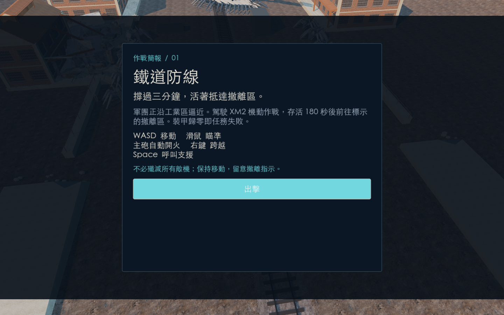

啟動器：開啟工作目錄的 `play-3d-local.command`。這是本機Godot視窗，不是網頁版；依賴目前本機Godot路徑，尚未封裝安裝包。既有2D入口、v45平衡與正式站不變。

目前可操作內容：玩家XM2四足IK；Ameise模型分近接與射擊兩種行為；Morpho定點重砲警戒；四個高低障礙與射線遮擋；核心碰撞、躍進與支援；敵機物件池；每擊毀五台補8耐久。這些仍是第一個玩法測試配置：近接／射擊共用模型，敵方完整步態、可擊破重型Boss、玩家槍口骨骼同步、音效、材質與完整碰撞／平衡仍不足。不能宣稱原Goal三種成熟協同軍團與完成度已達標。

S61協同收尾增量：斥候維持1.8秒視線才完成標定；高掩體、超出距離或擊毀斥候可中斷。標定成功會交給重砲舊落點並促使獵兵加速，重砲保留2.8秒預警、不追蹤新位置。獵兵先鎖點預告1秒，再向該點突進；側移、掩體、躍進可反制。蓄勢／突進期間只對正面砲擊減傷60%，側擊和範圍支援不受影響，其他血量、傷害不變。獵兵仍使用Ameise暫代模型，這是行為接通，不能當原作機型／動畫完成。

[協同控制測試](probe-assets/s61-mission-coordination-qa.json)通過標定開始／被掩體或擊毀中斷、重砲舊落點與預警時間、獵兵預告／側移避開／掩體阻擋、正面減傷／側擊與支援穿透，以及重試清除協同狀態。測試使用固定位置與冷卻，證明分支可反制，不能替代真人體驗。

第一輪自然計時回歸是重要反面證據：雖然195.65秒成功撤離，但21次標定全中斷、獵兵突進零次，滿血擊毀132台，幾乎與前版相同。保留[蓄勢防護前報告](probe-assets/s61-coordination-soak-before-guard.json)，因此只修正獵兵進場蓄勢及正面防護，不全面拉高敵軍數值，也不將綠燈當成壓迫感通過。

修正後[整局回歸](probe-assets/s61-coordination-soak.json)：遊戲188.53秒／牆鐘196.98秒成功撤離，擊毀116台、躍進13次、支援2次；自然觸發13次獵兵鎖點、2次獵兵命中、5次標定成功、7次標定中斷。這證明機制能在正常任務中發生，並未證明完整協同與真人難度已合格；精準控制器仍以120耐久結束。既有2D與正式站不改，原生本地啟動器已使用此候選版。

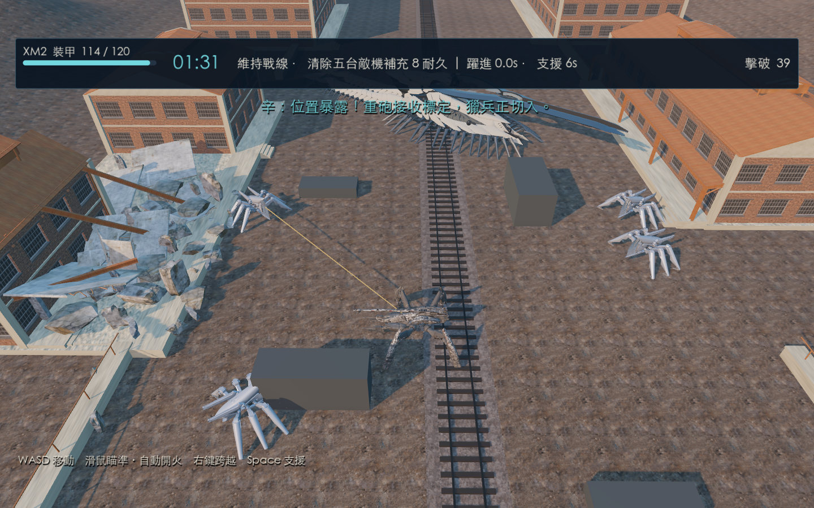

流程自動測試實際跑過開始、敗北、重試、撤離成功與返回整備，並測一次同幀右鍵按下／放開只觸發一次。為驗證狀態機，測試注入HP和時間，**不是完整180秒生存驗收**。正式遊玩模式仍為180秒後開放撤離，沒有使用測試縮時。

原生視窗曾記錄到移動、自動射擊與一次支援，但這些不是QA Agent發出的操作。CUA沒有辨識到執行中的臨時Godot遊戲；因此未完成獨立原生按鈕／整局操作驗收，不能採認「已有人操作」為QA通過。遊戲process以exit0結束，沒有引擎error，原因未確認。角色／地形美術仍未通過，Sprint E2E驗收尚未完成，不發布。

互動回歸補查：在真實物理空間以固定位置驗證射擊傷害、擊毀後碰撞移除、高掩體擋彈／擋行走、低掩體上方射線、重試清場。躍進原本會落在低掩體內，已改為保留最近有效落點，阻止陷入障礙。修正後上述檢查全部通過。[修正前](probe-assets/s61-mission-interaction-before.json)／[修正後](probe-assets/s61-mission-interaction-qa.json)。這些只涵蓋四個原型掩體與機體核心膠囊，未代替整場人工試玩。

後續Sprint Goal改以可驗收的一次玩家旅程切分；動作、素材、數值只列支援這條旅程的Task。下一個驗收必須玩完整一局，確認掩體、技能、撤離與重試真的有用；不得再只交步態影片或材質比較圖。

### S61 收尾：未縮時的整局自動試玩

2026-09-13，使用 `mission-soak.gd` 繼承實際任務，透過Godot鍵盤／游標事件巡迴、瞄準畫面內且射線可達的敵軍、支援與躍進。未修改血量、傷害、冷卻、生成或任務時間。實際遊戲時間195.62秒、牆鐘196.97秒，180秒後開放撤離，角色確實移動到撤離圈才出現勝利結算；程序exit0。

擊毀132台、射擊903次、躍進13次、支援1次，結束耐久120。每10秒採樣的敵軍存活數0–3、特效數0–3；這不是全幀峰值，也不作效能或記憶體無洩漏證明。控制器利用引擎狀態精準瞄準，不能推論真人也會滿血，但足以指出目前配置尚未證明軍團協同壓制、掩體決策與技能必要性。

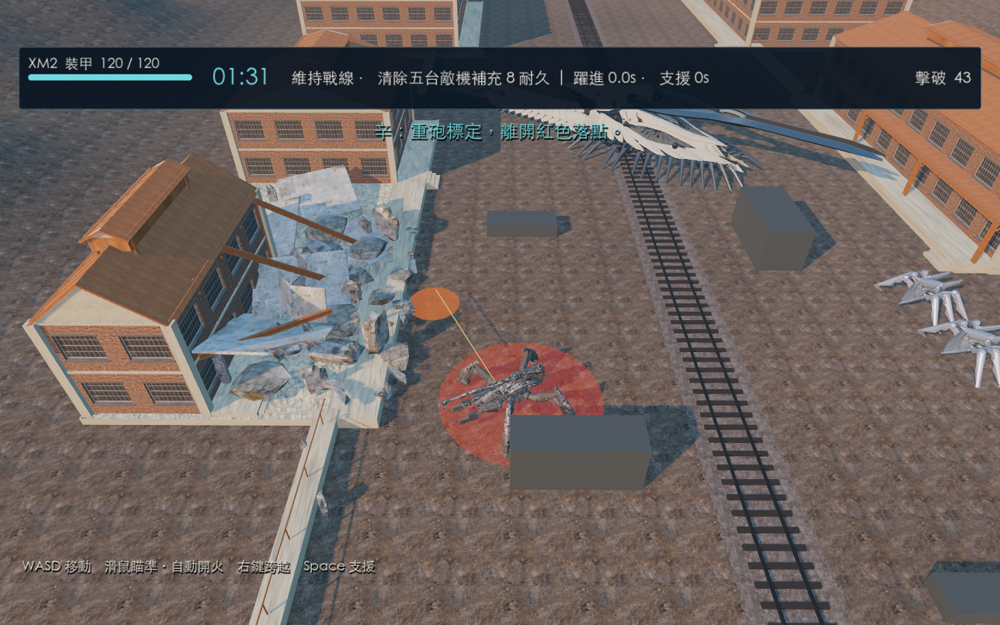
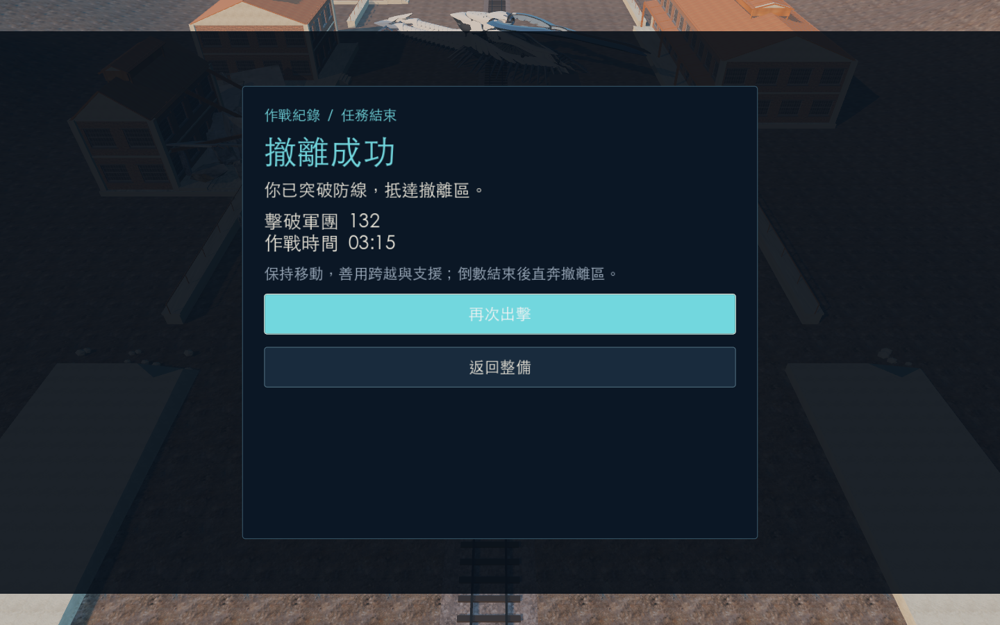

[完整結果](probe-assets/s61-mission-soak.json)；重跑命令：`Godot --path art-direction/86-reference/probe-assets/s53-godot --script mission-soak.gd -- --collapse`。這是自動控制器整局測試，啟動直接呼叫任務，未驗原生UI按鈕與獨立人工操作。CUA本輪取得的仍是專案管理員，沒有取得遊戲。獨立E2E／美術門檻仍未通過，不發布。

下一個產品Story應是「玩家在一場撤離任務中，能辨識斥候標定、獵兵逼位、重型封路，藉掩體與躍進反制，並清楚看到與聽到攻擊結果」。優先補這一場的協同、模型動作、砲架與命中對應及現成場景掩體；不要再以單獨材質／步態迭代冒充Sprint Goal，也不要根據精準bot結果直接提高全部數值。維持原Goal與既有2D；Plan／Review均65%用量，只收尾、不新派工。

## S61：XM2 真正四足直行、轉彎與停止

S60已確認足端座標，本輪直接實作 runtime 兩節腿部IK。四足分相抬腳；站立腳保留世界座標，擺動腳根據移動／轉向預測下一個接地點，以實際物理射線取得地面。原GLB與既有貼圖不改。這是動作控制器，不是內建動畫或整機根位移的替身。

[播放16秒步態驗證影片](s61-locomotion.mp4)：2秒靜止→4秒直行→6秒移動並轉90度→2秒直行→2秒停止。384幀、720p、24fps為離線輸出設定，不是即時效能宣稱。尚未做玩家鍵盤、全場碰撞或戰鬥。

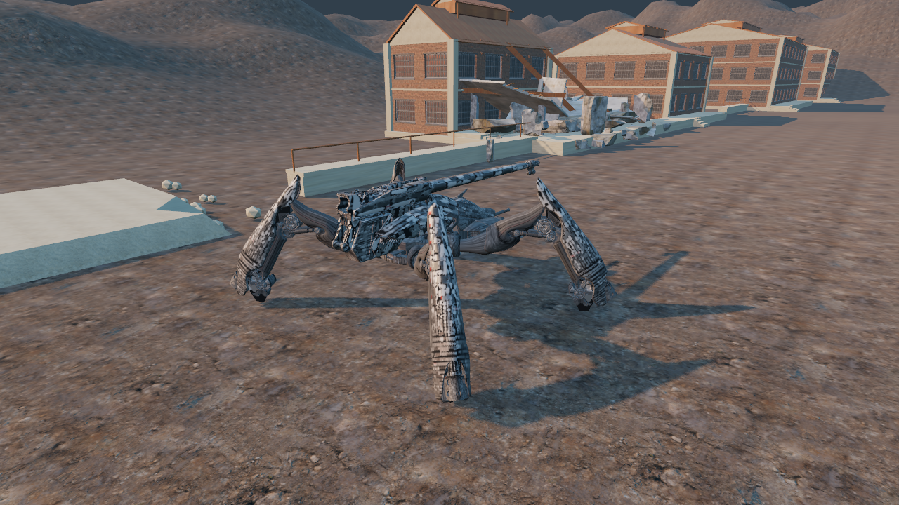

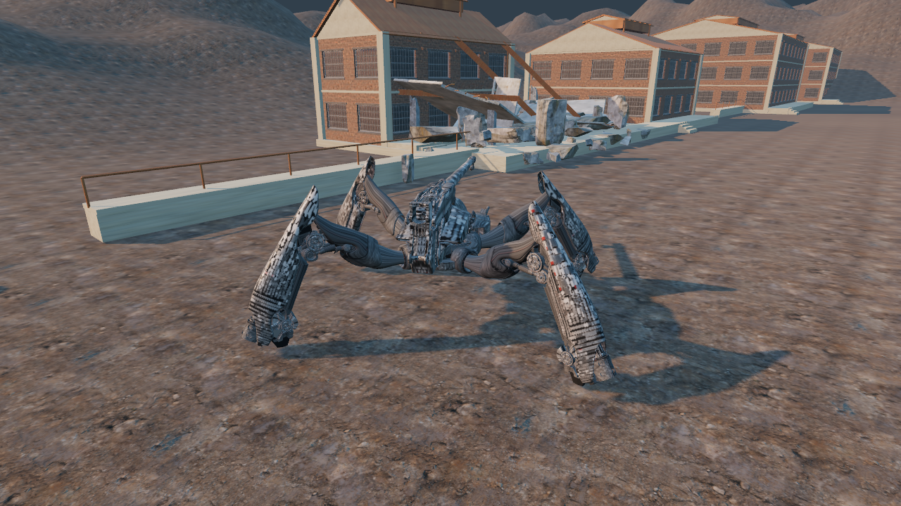

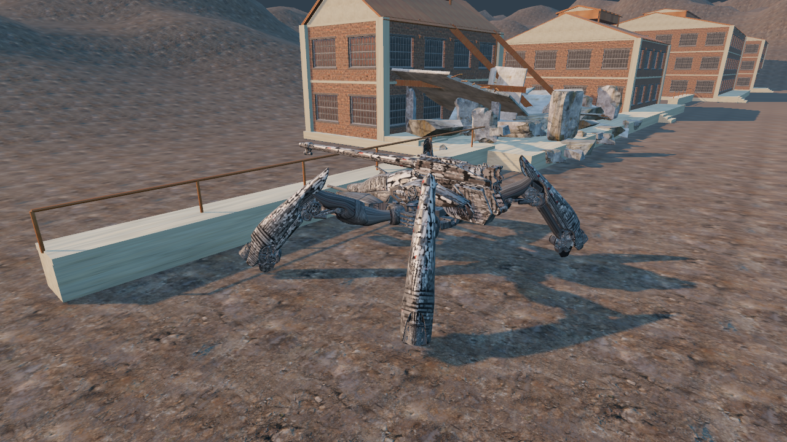

Godot對768個求值影格重新從實際骨架計算足端；目前最大target誤差約0.0023mm，連續支撐足單幀水平漂移約0.0029mm，沒有超距或腿長拉伸。停止後不再啟動新抬腳。這些量測只支持平地足鎖，不等於所有幾何接地都正確：每半秒抽取一次的posed網格最低點最深進入物理平面約5.5mm，而既有可見地面比測試平面低4cm，兩者仍要統一。

獨立Astra美術QA查看11張動作影格，確認關節參與且停止姿態一致；沒有連續播放全片，因此不宣稱全程動作觀感通過。主要未完成的是機身承重轉移：下一步跟隨支撐腿計算小幅高度／側傾與停止收步，不能只加固定週期上下晃動。低坡及故意超距另有數值測試，尚無對應完整渲染驗收。

可重現：`probe-assets/s61-xm2-gait.gd` 與 `probe-assets/s53-godot/locomotion.gd -- --collapse`；逐幀資料 `probe-assets/s61-locomotion-run.json`。射線依[Godot官方說明](https://docs.godotengine.org/en/stable/tutorials/physics/ray-casting.html)，骨架global pose是相對Skeleton，需再乘世界變換，依[官方骨架API](https://docs.godotengine.org/en/stable/classes/class_skeleton3d.html)。射線目前只對中央平坦區測試collider，不能稱為整張工業廢墟的碰撞。

整體美術、步態承重／坡地／躍進、砲架協調仍待驗；斥候／獵兵／重型敵軍、掩體射線與完整任務流程仍是原Goal，不以本片代替。

## S60：軍團材質分區與真正步態的輸入驗證

本輪沒有再下載同類素材。Morpho原檔無貼圖，新增的是專案材質設計，不能稱為找回原作貼圖。151個網格／246個表面共用11個材質與3張256px細節圖；裝甲為非金屬塗層，腹部機械與砲軌分別指定裸金屬，感測器保留。原GLB不改。Godot實際渲染前檢查原生紋理已產生，所有比較固定S59光照／曝光。

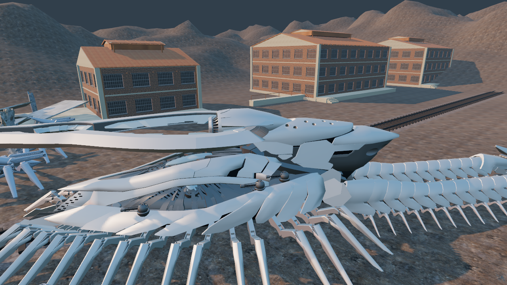

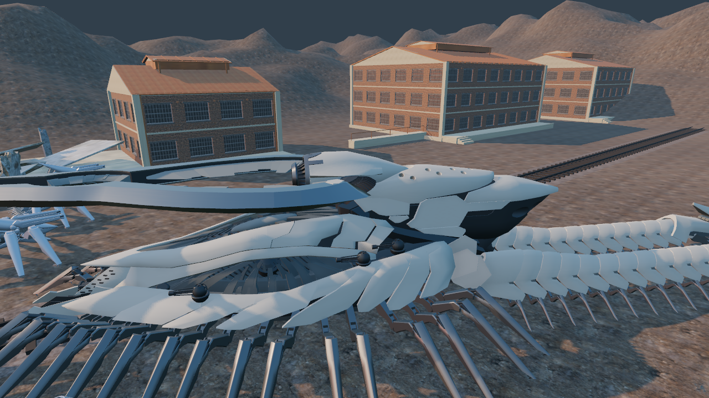

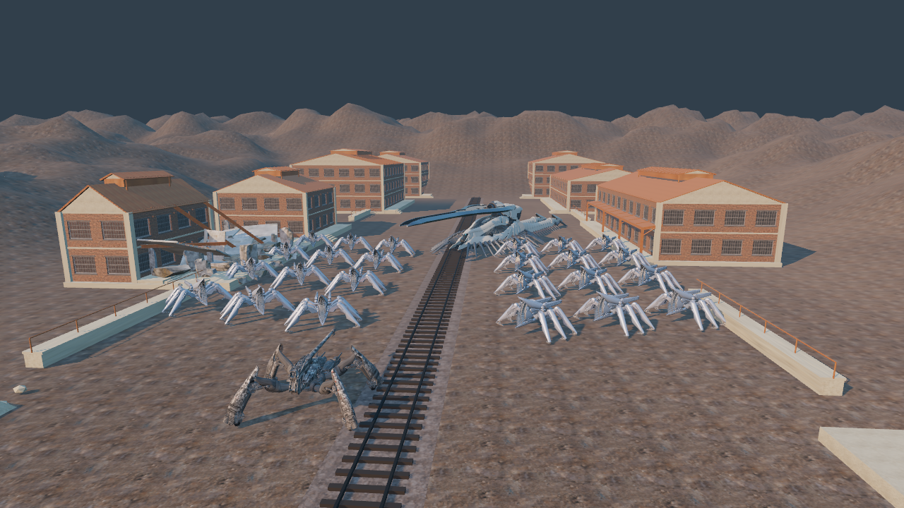

獨立Astra Review：分區改善成立，長砲與機械沒有一起糊黑；但主要差別仍是色塊，寬大裝甲缺乏可信的反射層次，**材質完成度與整體美術皆未通過**。乾淨不是錯，不能用亂加髒污替代材質設計。後續只以一組代表裝甲板驗證貼合零件的粗糙度／接縫，不全面堆噪點；目前分區僅由 `--material-review` 載入，尚未指定為正式材質。

另一條工作線直接檢查動作：XM2有54關節但無動畫；Ameise只有兩前足近端13.75度的同相測試，不是walk。原有M1A4的S52解析式兩節IK可重用方法，無法直接搬clip。S58玩家的跳躍與移動僅是整機根節點編舞，不是多足動作完成。

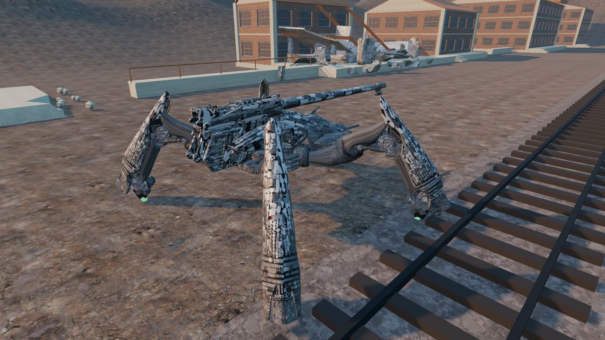

Sol以GLB幾何／權重量測四腳尖；PO實際Godot驗證抓到第一版錯誤：只用nodeWorld乘頂點，漏了inverse-bind。兩種轉換在6.3m正規化後最大相差0.626m。腳本改用完整加權jointWorld × inverseBindMatrix，並重新量測接觸面及腿長；Godot四腳距實際posed最低面最大約0.00000042m，通過2cm靜態門檻。這只證明rest座標可用，沒有證明行走、轉向、坡面或關節限位。

可重現資料：`probe-assets/s60-xm2-foot-sockets.py`／JSON、`s60-xm2-godot-sockets.json`、`s60-material-run.json`。Godot腳本沿用 `combat.gd -- --collapse --material-review` 或 `--socket-review`。原模型沒有被覆寫。[NoiseTexture2D官方文件](https://docs.godotengine.org/en/stable/classes/class_noisetexture2d.html)與[材質API](https://docs.godotengine.org/en/stable/classes/class_basematerial3d.html)為本次原生細節的依據，不宣稱取得新PBR素材。

下一個可玩方向保持原Goal：先以實測socket做XM2世界空間落足與轉彎，驗證後擴展Ameise接敵；不再用更多靜圖替代行走／射擊／掩體互動。3–5分鐘任務、完整流程與獨立實機QA仍待完成。

## S59：連續坍塌區通過局部用途驗收

本輪從同一份環境製作腳本延伸，使用已收藏的 Fleurman 破板／斷柱，替換左廠房一段結構，保留右側廠房作尺度對照，後景中央開出鐵道路徑。第二次修訂降低懸板，增加 27 塊來源碎片形成廠內→月台→地面的集中瓦礫；沒有向全場撒碎片。

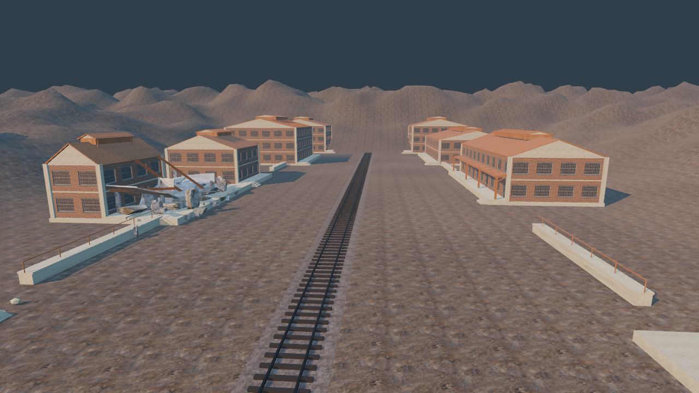

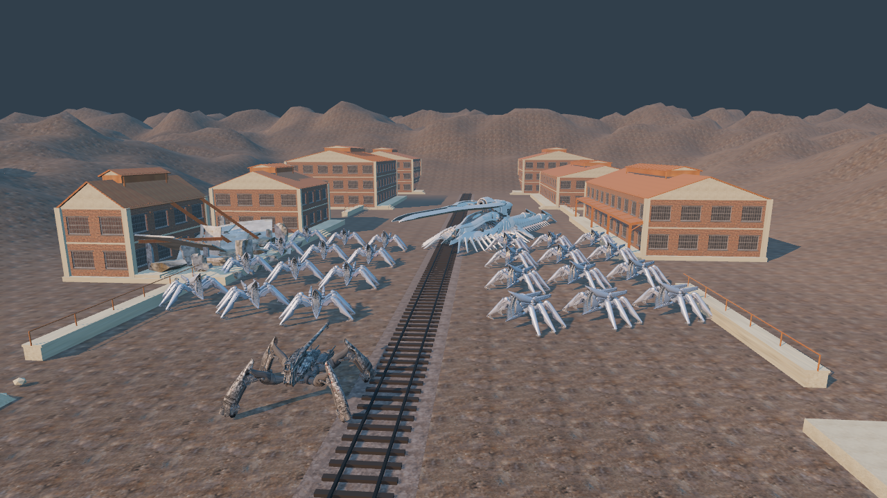

Astra 獨立靜圖 Review：**本輪結構目標可收下；整體美術仍不通過**。左側已不再是孤立斷樓，坍塌與月台建立連結；不再追加第三輪碎片微調。中央遠景路徑可見，但這不是導航／碰撞驗收，也未證明遠方整段鐵軌可通行。

最終 GLB 66.33MB、約203.26萬場景三角面、18張內嵌圖。主 Agent 再驗 SHA-256 與內嵌圖片，不把大型研究檔載入正式遊戲。Apple M3／Godot Metal Forward+、1280×720靜態軍團同框：300個連續幀間隔的中位 14.15ms、P95 14.78ms、P99 15.02ms。測量包含呈現等待，沒有AI、輸入、交火負載；**不是戰鬥FPS保證**。方法使用 [Godot單調時間](https://docs.godotengine.org/en/stable/classes/class_time.html)，原始300筆資料存於 `probe-assets/s59-environment-run.json`。

### 材質問題已追到原檔，不再猜漏貼圖

Sol 技術美術稽核、PO 複查實際 GLB：Ameise 的2K色彩／法線與封存原圖逐位元相符；metallic／roughness引用的原依賴缺失，匯入使用固定0.48／0.42。Morpho原Unity材質沒有貼圖欄位實檔，GLB亦為0 images／8個常數材質；不是Godot把貼圖弄丟。這是需要補製表面內容的缺口。

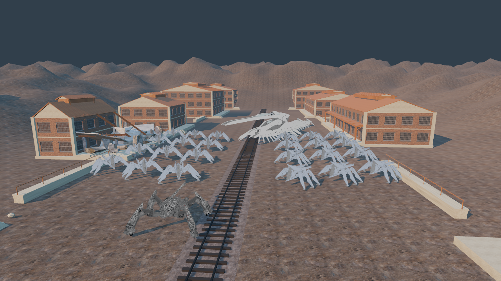

原色對照仍呈現淡白低對比軍團；不能單靠加霧或壓暗解決。另試過把既存照明HDRI直接作可見背景，模糊樹線與地形接不上，故不採用，保留對照避免往後重試同一假設。

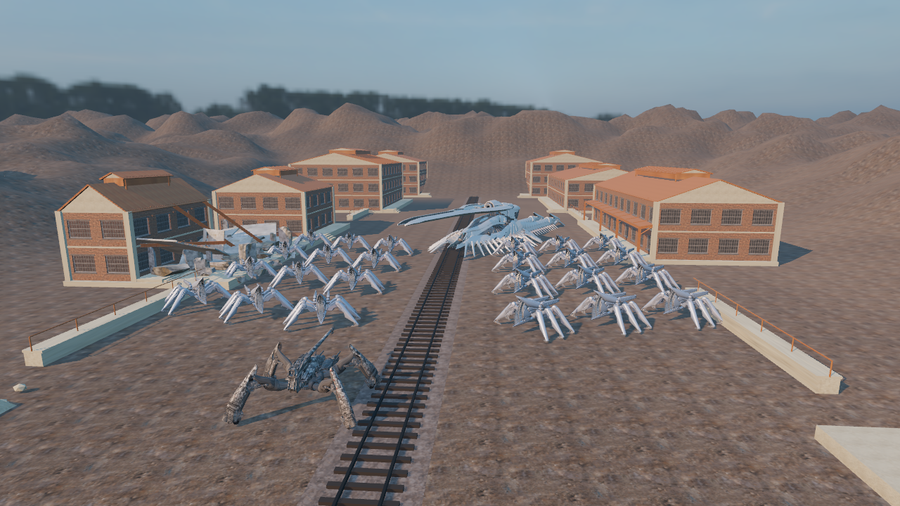

### Review 形成下一步

1. Morpho材質先行：以既有幾何建立裝甲、裸露機械、砲軌表面差異，近景與全場固定光照比較；不是只把整機染深。Ameise保留已驗色彩／法線，再補缺失材質參數。
2. 完整步態／接敵動作：XM2、Ameise前進、轉向、落足、射擊需連續驗證，不能再以姿勢截圖代表已完成。
3. 材質基準成立後才統一全場光照及遠景。不增加更多廠房細節、VFX種類或新章節來迴避上述缺口。

保留完整3D任務、三種協同敵軍、高低掩體射線、整備與勝敗撤離等原Goal；這次結構驗收不取代它們。2D穩定核心未修改，研究頁同步本地供回饋。

## S58：同場交火試驗，完整美術仍未通過

先驗一發砲的前後過程。[開啟 12 秒交火診斷影片](s58-combat-v3.mp4)：Godot 實際輸出 1280×720、288 幀、24 fps 編碼，**是離線編排，不是即時效能或可玩任務證明**；沒有音訊驗收。

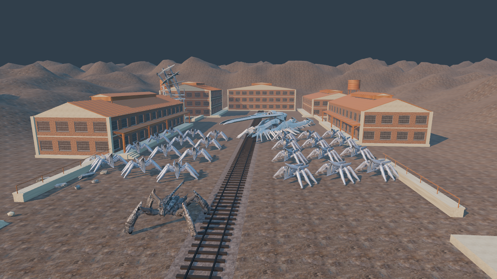

第一版將黑底 RGB 火球大幅放大並維持 0.85 秒加色顯示，形成透明大泡；白煙貼圖的深色邊緣也變成黑圈。修訂保留既有來源，火球縮至短峰，換用既有黑煙並加少量粒子火花；彈道由瞬時整線改成移動的短曳光。依 [Godot Sprite3D 文件](https://docs.godotengine.org/en/stable/classes/class_sprite3d.html) 使用實際貼圖序列，沒有從參考影片抽取素材。

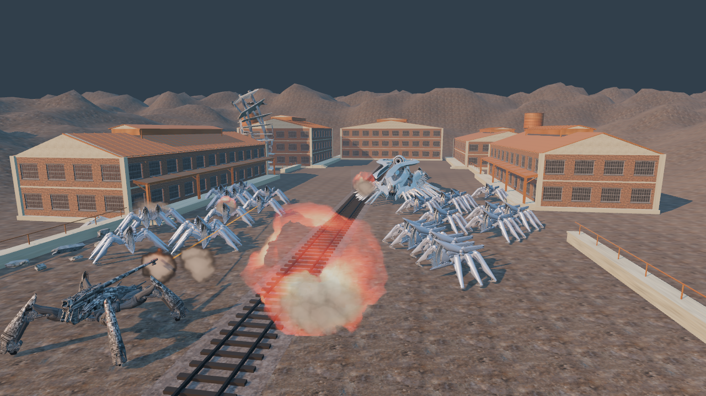

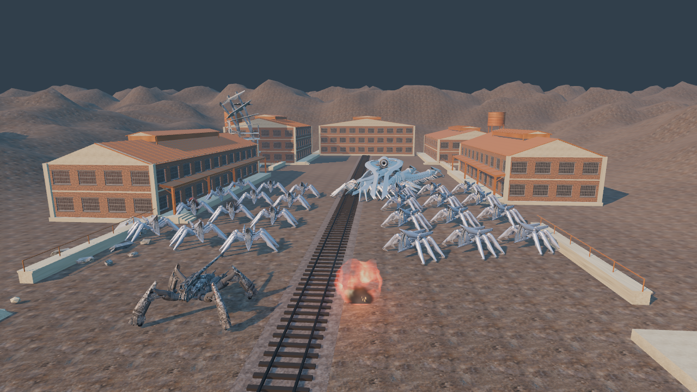

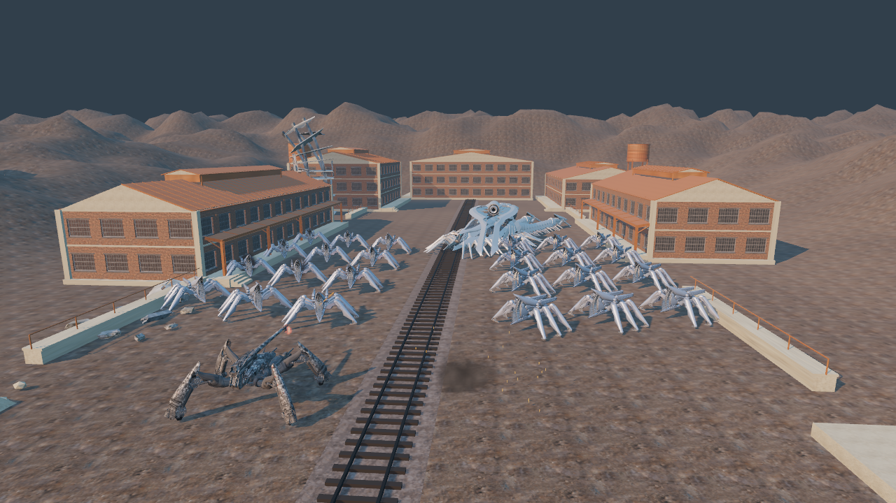

記錄為 9 次發射與 9 次命中事件，結束時煙塵／閃光暫態節點已清除。這只驗證試驗腳本事件與生命週期，不是遊戲傷害、命中判定或長時間記憶體測試。Morpho 原始前進 clip 有求值；Ameise 仍靜止，主角僅根節點躍進／後座，我方砲口仍是臨時偏移；不冒稱完整步態、砲架與後座完成。

獨立美術 Review 已退回第一版：Morpho 正面透視縮短失去尺度、主角裁切、煙球搶走視線、完好廠房及孤立斷樓仍像展示。第二版修正主角裁切及敵群重疊，但整體廢墟、材質與威脅關係仍未通過。既有 2D runtime 與公開站不變。

Morpho 的實測補正：模型角色從導軌網格、骨骼與原 GLB TRS 反算砲口，位於 `railgun_turret` 的局部 `(0, 999.88922, 0.032805)`，前方為局部 +Y。這是來源單位，完整骨骼世界變換已含模型縮放。既有動作有常數砲架 tracks，會覆寫自訂姿勢；第三版因此在 clip 求值後施加瞄準，再從同一骨骼變換發射。依 [Godot Skeleton3D 文件](https://docs.godotengine.org/en/stable/classes/class_skeleton3d.html)，骨骼 global pose 仍相對 Skeleton，不能誤當世界座標。

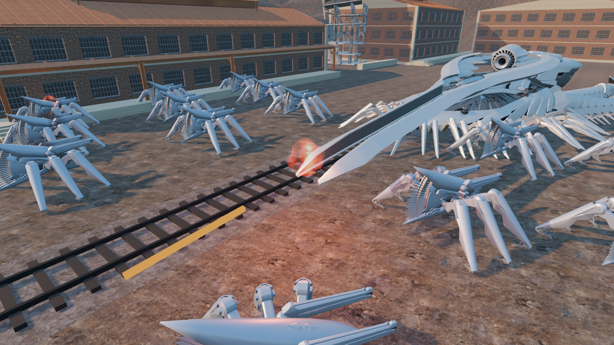

第三版腳本記錄射線與指定地面點約 0.0497m 偏差；獨立近景 QA 支持火光在雙軌前端、曳光方向相符，**不代表動畫全程通過**。砲架目前是受控姿勢試驗，尚缺機械關節限制、獨立砲管後座與遊戲射線碰撞。量測保存於 `probe-assets/s58-morpho-muzzle.json`，原始 GLB 雜湊未變。

Review 改變下一輪排序：先用已有戰損資產替換左側廠房中後段，形成連到月台的連續坍塌區；保留前端立面及右側完整廠房作尺度對照，移除孤立突出斷樓。固定鏡頭、不開特效也能讀出結構關係才過關。全場仍退件，暫不細修更多 VFX。

## S57：已取得有體積的戰損素材

Fleurman的CC0 Destroyed City Assets已下載、解壓、Blender匯入及渲染：61網格／15,857三角面／6張內嵌色彩圖。匯入需重接材質色彩圖，原始單位與FBX多餘layer警告尚有保真限制。美術總監同意作側後景廢墟與局部坍落掩體，**不適合直接替換整個工業場景**。

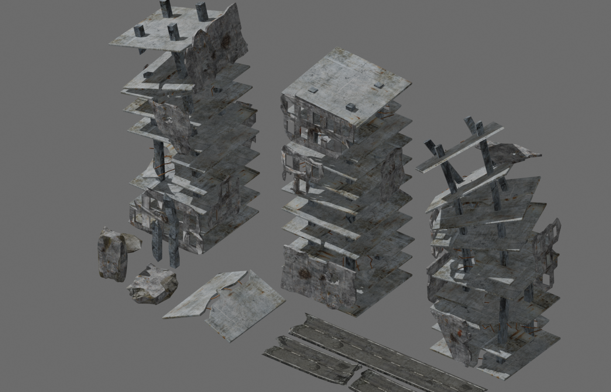

原始檔：`assets/model/oga-destroyed-city/`；衍生GLB與檢查報告：工作目錄 `art-direction/86-reference/probe-assets/s57-destroyed-city-*`。新素材來源、限制及其他候選見 [環境管線S57實檔紀錄](s53-environment-pipeline.md)。下一步用已取得斷片建立局部坍落帶，接回同場移動與砲火，不再繼續排完好牆片。

## 收藏入口與使用規則（S56 更新）

先查這份索引，再搜尋。原始模型／貼圖已留在 `assets/model/`，匯入與場景衍生物在 `.worktrees/s45-3d-sortie/art-direction/86-reference/probe-assets/`。影片保存官方連結、時間碼與實看筆記，未下載影片，也不把影片當成可使用的遊戲素材。

- **素材總索引**：`s54-asset-archive.json`，含原檔、衍生檔位置、來源、授權範圍、大小、SHA-256、驗收階段。S56 重驗36個原始／依賴檔，以及4個衍生GLB的雜湊。
- **畫面參考索引**：`s54-reference-index.json`，已看過的AC6、The Ascent、Helldivers 2片段直接定位；不重複搜尋同一段。
- **匯入／製作證據**：`probe-assets/s55-*.json`、`s56-rail-environment.json`、`s56-encounter-run.json`；下載成功、引擎可讀、美術通過和即時可用是不同階段。
- **缺項才補收集**：檔案存在且校驗符合就直接重用；需要新動作、破壞場景或缺失貼圖時，只補該項並更新索引。原檔不覆寫，衍生物保留處理腳本。

|收藏類別|已有資源|使用判定|
|---|---|---|
|我方機甲|使用者提供M1A4；Project-86 XM2與早期M1A4|模型已入庫；XM2無內建動作，Project-86個別素材對外再散布仍未釐清。|
|軍團|Ameise、Morpho及其材質／貼圖／骨架|已有引擎驗證；Morpho有前進clip，但全場動畫、比例與效能未通過。|
|工業環境|Poly Haven廠房門窗牆面；粗混凝土、鏽金屬；S56完整廠房組合|CC0來源可重用，組合仍屬美術候選，不等於完成廢墟。|
|地表|rocks_ground_08、rubble，兩套1K色彩／法線／ARM／位移，共約9.08MB|原始8檔大小與SHA-256吻合。地表貼圖已用於本地試驗；位移圖尚未用。|
|爆炸與煙|Sinestesia爆炸atlas、Kenney煙塵、lava-blast序列|沿用既有素材；各自授權見VFX CREDITS，尚未通過3D交火驗收。|
|對照畫面|AC6工業交火與巨型機械、The Ascent環境分層、HD2機械軍團|只作畫面參考；已觀察範圍詳列下方，未宣稱完整影片或音訊驗收。|

## S56：素材組合的實際環境檢查

新下載只補地面缺項，來源為 [Poly Haven rocks_ground_08](https://polyhaven.com/a/rocks_ground_08) 與 [rubble](https://polyhaven.com/a/rubble)；沿用其 [CC0授權](https://polyhaven.com/license)。原始API回應、下載網址及校驗資料保存在各自目錄。

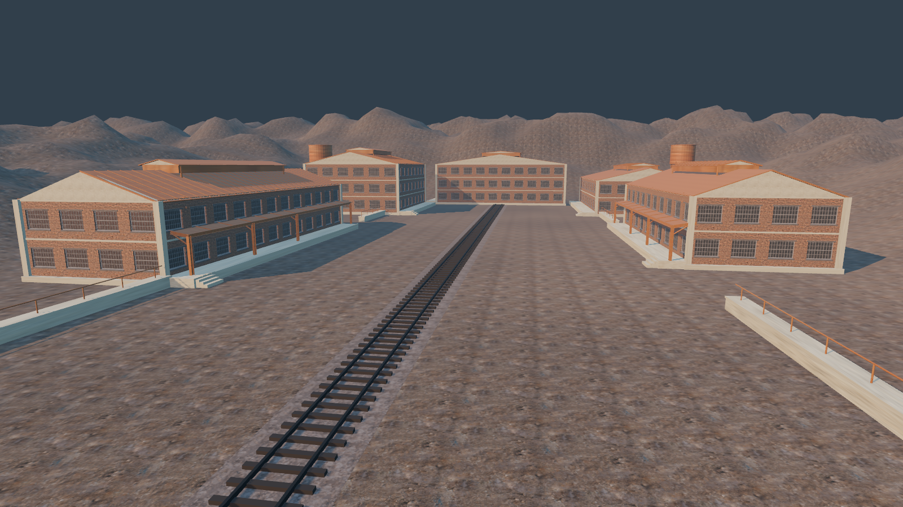

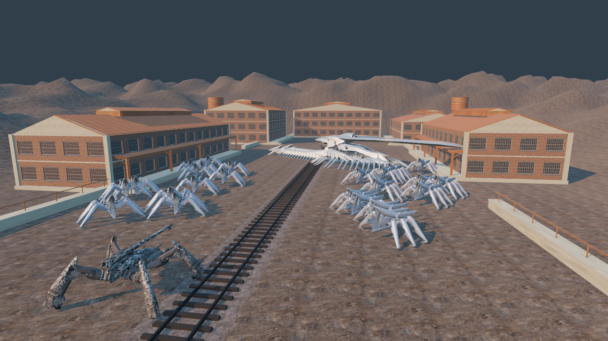

本輪以既有廠房套件組成五座有屋頂、側背牆及基座的廠房，加入雨棚、月台與水塔。原始衍生GLB為51.38MB、約181.9萬場景三角面；仍過重。Godot依35m區塊，將363個靜態重複實例放入10個MultiMesh群組；這不是軍團骨架合批，也不是FPS通過證明。

地形試驗為400×480m，中央維持平整，遠側提高地勢。首輪實測發現三角形面朝下，使地面被剔除；修正索引順序後，法線Y由負轉正，地表與接地陰影已在重出畫面確認。沒有以雙面材質或濃霧掩飾問題。最終圖由Godot／M3 Metal Forward+實際輸出。

結構改善不代表戰場美術完成：目前仍有整齊廠房、反覆地表與缺乏破壞／交火事件的問題。Astra獨立Review：整體美術不通過。下一個素材缺口是有體積戰損的工業／鐵道遺址套件，需破頂、斷裂月台、結構瓦礫及合理軌道出口；不再重複排完好牆片。詳細見 [獨立QA](s54-encounter-reference.md) 與 [Sprint紀錄](sprint-journal.md)。本頁圖片保留作後續比較，2D遊戲不受影響。

## S55：實際匯入與整場診斷，尚未通過美術驗收

2026-09-13。兩個新模型已經在 Blender 匯入並轉成內嵌貼圖／材質的 GLB，再於 Godot 4.7.2、Apple M3 Metal Forward+ 實際渲染。下面是引擎截圖，不是生成概念圖，也不是新遊戲版本。

|資產|實檔結果|尚未通過的項目|
|---|---|---|
|XM2／Reginleif|445,798三角面、59網格、54骨、0內建動作；1K PBR內嵌|即時負擔過高、需LOD／動作；法線G方向未獲作者資料確認。|
|Morpho|126,688三角面、774骨；GLB含前進與兩個單幀動作|40.2m長度校正後，目前姿勢高度約5.44m，與官網11.4m未對齊；不拉伸模型假裝符合。|
|軍團群|24台既有Ameise共用模型／材質資源入鏡|這不是24台完成步態、AI與效能的遊戲驗收。3.8m長度是構圖假設，非官方尺寸。|

匯入修正證據：Godot的未蒙皮mesh AABB會重複套根位移／縮放。Ameise一開始被錯量成約0.598m長，變形後實際界線約3.603m；改用骨架初始化後的姿勢烘焙界線，修正誤放大與接地基準。原始模型未修改。[Godot官方方法說明](https://docs.godotengine.org/en/stable/classes/class_meshinstance3d.html#class-meshinstance3d-method-bake-mesh-from-current-skeleton-pose)

已在引擎對Morpho前進clip取1.2與2.4秒姿勢；圖像不同且可見足部姿勢改變。這能證明clip可求值，不能替代連續步態、腳滑、射擊協同或3–5分鐘效能驗收。

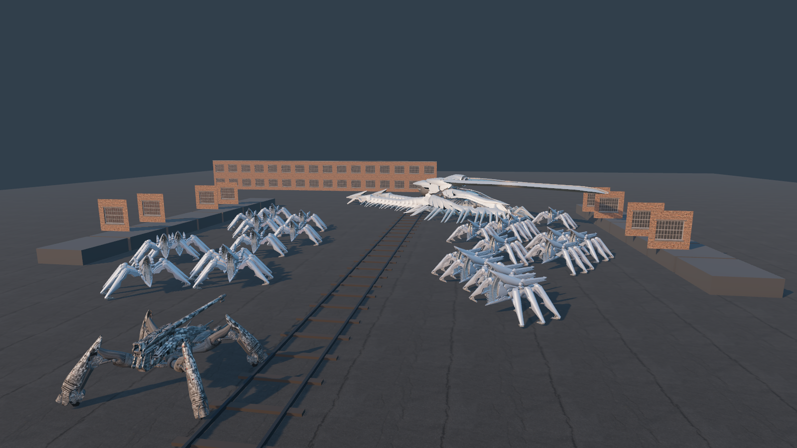

美術總監第二次審查：**整體不通過**。XM2和兩翼群體已有對峙關係，但重複牆片、無起伏鋪面、空白天空仍像展示走道；Morpho像側向停放，尚無施壓事件。主Agent同意，不發布為可玩增量。

下一個最高優先項：沿用此機體與固定鏡頭，收斂到一套能組成完整鐵道廢墟的場景資產。驗收時先隱藏機甲，仍須看懂前景位置、兩翼進入路線與Boss後方深度；不能有裸露地面邊界、孤立立面，也不靠濃霧掩飾缺件。之後才做10–15秒完整交火節奏，接回遊戲。

技術證據保存在 `probe-assets/s55-reginleif-import.json`、`s55-morpho-inspection.json`、`s55-glb-verification.json`、`s55-skin-bounds.json`、`s55-encounter-run.json`；可重現腳本與衍生GLB同目錄。此頁僅同步研究，不改已認可2D平衡。

## 先看這三組參考

影片保留官方來源、精確採樣位置與觀察筆記；未下載影片。以下是實際播放器畫面採樣，沒有完整連續看片或音訊驗收。畫面觀察與我們的實作建議分開，不能從截圖推定原遊戲底層技術。

|參考／直接定位|實際看見什麼|我們要解決什麼|
|---|---|---|
|[AC6 官方 Gameplay Preview：3:45 起](https://www.youtube.com/watch?v=DcDjyestr4Y&t=225s)|工業構架、混凝土與岩壁限定交火空間；機甲推進、暖色砲口與偏冷背景形成區別。採樣約3:50–4:00，未量測完整動作。|地形要參與交火，不能只做平面背景；機體後座、推進與落足要同步。|
|[AC6：STRIDER 接近段 7:09 起](https://www.youtube.com/watch?v=DcDjyestr4Y&t=429s)|7:09 開闊接近、遠景霧與電桿；7:54 近身時巨型機械足／軀體超出畫面，玩家仍有可辨尺寸。兩個採樣，不是完整連續驗收。|巨大感來自同地面參照物、輪廓及接近過程。Morpho 要保持原作長高，不直接抄 STRIDER 的高腳造型。|
|[The Ascent 官方 Xbox Deep Dive：6:24](https://www.youtube.com/watch?v=Xf6iELuLqM4&t=384s)|斜俯視工業步道的上下層、欄杆、管線、反光與霧光；此採樣未見射擊，作環境參考。|把可走路線、背景設施、遠方深度分層；參考空間組織，不照搬霓虹配色。|
|[Helldivers 2 官方機械軍團預告：0:30](https://www.youtube.com/watch?v=B9VdtdWRcZs&t=30s)|工業陣地中不同大小機械敵人、橫越畫面的射線、左側爆炸、灰色煙塵與暖色火光同框。已確認30秒附近交火畫面，未驗證音訊。|軍勢、砲火、陣地共同構成威脅；不要所有敵人同時發白光、每次命中都變大火球。|

## 最大差距與第一個完整畫面

目前瓶頸是戰場沒有形成事件：單機、平地、牆面各自存在，沒有我方與軍勢及巨砲同框的關係。加細一塊材質不能解決這個缺口。

第一個候選畫面：前景 XM2，中景 18–30 台 Ameise 分三股推進，後方鐵道上的 Morpho。數量是構圖提案，不是原作編制。官方 Morpho 長40.2 m／高11.4 m；XM2 長6.3 m／高2.7 m，長度約6.38倍。高度的量測條件不同，不能直接把整個網格縮放4.22倍。[官方軍團](https://anime-86.com/mechanic/enemy/)／[官方我方機型](https://anime-86.com/mechanic/second-half/)

低角度展示鏡頭與正常斜俯視遊玩鏡頭分別驗證。前者確認魄力，後者確認腳邊退路和射線；不能只交漂亮的不可玩鏡頭。第一步驗收整個構圖，再處理材質、動畫及特效。

## 素材實際保存位置

路徑均相對專案根目錄。原始檔保留，衍生檔另存；不把大型研究原檔加入遊戲載入或 Pages 發布。

|用途|本地位置|目前狀態|
|---|---|---|
|玩家提供的 M1A4|`assets/model/juggernaut_86_eighty-six.glb`|既有1K實檔；已驗95,482三角面、無內建骨架動畫；不是XM2。|
|Reginleif／XM2 候選|`assets/model/project86-source/Reginleif_Model.fbx`|已下載14,005,052 B，LFS SHA-256吻合；S55已匯入，59網格／54骨／無內建動作；美術與即時預算未通過。|
|Morpho 候選|`assets/model/project86-source/morpho walk forward anim.fbx`|已下載91,856,124 B，LFS SHA-256吻合；S55已匯入，前進clip姿勢可求值；連續動作、官方高度與即時預算仍待驗收。|
|Ameise 原始模型／貼圖|`assets/model/project86-source/ameise/`|從S51暫存歸檔，含原FBX、原貼圖、2K衍生貼圖與先前匯入檢查。|
|早期 Juggernaut 原始模型／貼圖|`assets/model/project86-source/juggernaut/`|同上，避免暫存被清掉後重新取得。|
|工業牆、門窗與PBR|`assets/model/polyhaven/modular_factory_facade/`|既有17檔、約17.6MB、CC0；有 intake-manifest；不是完整廢墟或鐵道場景。|
|爆炸序列|`assets/vfx/sinestesia-explosion-2-*.png`|既有CC0 atlas；先用於3D平面粒子試驗，尚未做3D視覺驗收。|
|煙塵|`assets/vfx/kenney-smoke/`|既有4張CC0煙塵PNG；不要重找同組。|
|火球序列|`assets/vfx/lava-blast/`|既有32幀、CC-BY3.0；黑底RGB，適合發光混合，不適合做遮蔽黑煙。|

新檔的來源URL、Git LFS指標、位元組與SHA-256存於 `assets/model/project86-source/intake-manifest.json`；舊檔歸檔雜湊存於同目錄 `s51-archive-manifest.json`。Project-86 根GPL不等於各項第三方素材對外再散布已釐清，目前作本地研究候選。詳細來源沿用 [既有授權／重用稽核](project-86-reuse-audit.md)，不要每次重新判讀。

本輪歸檔合計28個資料檔、166,167,319 B（約166 MB），逐檔重新核對manifest中的大小與SHA-256。另保留LFS指標與說明文件。Reginleif三張必要貼圖、Morpho八個材質描述及兩個FBX meta亦已保存；這不等於完成跨引擎匯入。

## 怎麼做：以既有資產和引擎功能組合

以下是我們的候選作法，尚未實裝，也不是宣稱參考遊戲採用相同技術。

|畫面問題|最小實作路徑|驗收證據|
|---|---|---|
|巨砲沒有尺度|匯入Morpho、依官方尺寸校正；鐵道／電桿／同地面敵群作比例參照；相機固定對照。|兩種鏡頭都能辨識我方、軍勢、巨砲，不靠名稱或血條說明。|
|敵人像複製玩具|近處少量完整步態，中景共享網格／材質並錯開步伐，遠景降細節；編成保留間隙。|18–30台同框的實際幀時間、輪廓及接地；不得宣稱骨架可直接MultiMesh批次播放。|
|特效只是一閃|一個攻擊拆成瞄準／蓄力、砲口與後座、飛行、落點火花與碎片、餘煙；既有atlas配3D粒子。|同一發砲從來源到落點可追蹤，煙不遮掉逃生區。|
|場景扁平|既有工業套件作兩翼，中央保留鐵道與射界；近景碎石、中景敵群、遠景煙塵及地平線分層。|灰階縮圖仍看得出主角、威脅與路線。|
|材質像塑料|先核原貼圖接法、正常曝光與環境光，再針對塗裝／裸露金屬區分粗糙度；不全物件拉高metallic。|同鏡頭原材質／修正材質對照，不用全面霧化掩蓋錯誤。|

The Ascent 團隊公開說明使用可重用環境組件、主材質與材質實例，並混合烘焙／動態光，部分特效使用 Niagara。值得借鑑的是建立可重用資產組合，不是為了模仿而再架一整套 Houdini 管線。[開發者訪談](https://www.unrealengine.com/developer-interviews/11-person-studio-neon-giant-delivering-next-gen-passion-project-the-ascent)

Godot 現有 GPU 粒子可使用網格繪製通道，適合先把現有煙塵／爆炸素材做成有限的3D特效。[官方粒子文件](https://docs.godotengine.org/en/stable/tutorials/3d/particles/creating_a_3d_particle_system.html) 體積霧需 Forward+，短促閃光要處理時間重投影的殘影；網頁／Compatibility 不可假定有同一效果。[官方霧文件](https://docs.godotengine.org/en/stable/tutorials/3d/volumetric_fog.html) MultiMesh 應分區，因為個別實例沒有獨立視錐剔除；不能只因能批次畫就無限堆軍團。[官方最佳化文件](https://docs.godotengine.org/en/stable/tutorials/performance/using_multimesh.html)

這些功能支持先做單場交戰驗證，尚不足以決定全面從網頁遷移。Context7 工具本輪不可用，因此核對上述官方文件；API實作時還須對照實際引擎版本。

## 下一輪直接接續，不重查

1. 先讀本頁與兩份manifest；來源檔已存在且雜湊吻合就不重新下載。
2. Reginleif／Morpho匯入已完成，直接讀S55結果；下一步是缺少的完整動作與即時成本，不重做下載／格式辨識。
3. 使用已有Ameise和環境素材做完整交戰構圖。先交整場，再交同場10–15秒的交火節奏試驗。
4. 只補尚缺的鐵道／大型Boss依賴／合適煙塵序列；取得來源和作者授權資料一起入庫。

不重查已核對的機型尺寸、不重新下載Kenney煙塵、不把漂亮影片當作已取得可用模型。影片與參考遊戲美術只作觀察，不從播放器擷取幾何或打包為遊戲素材。
